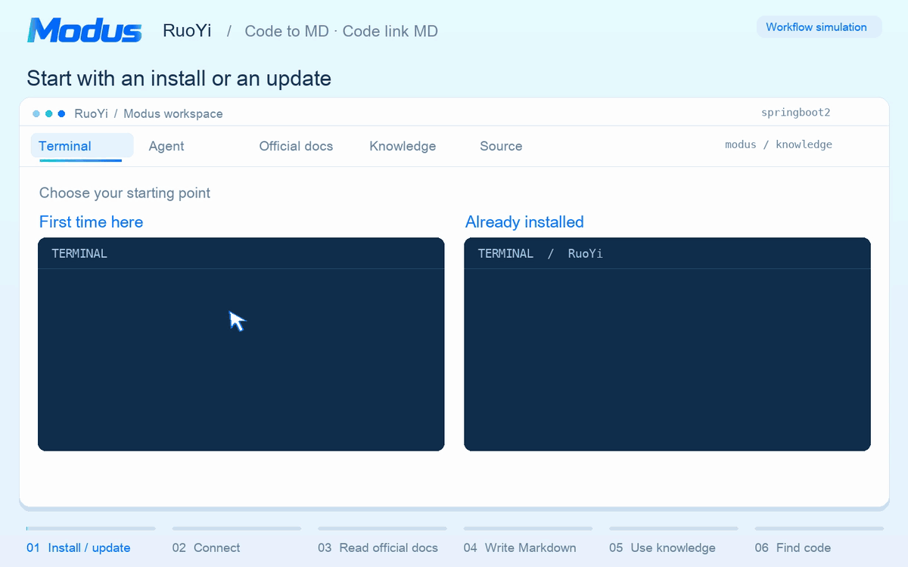

<div align="center">

<h1></h1>

**Take coding beyond code**

Install with `uv tool install openmodus` · Update with `modus update`

<p>
  <strong>Coding-agent platforms</strong><br />
  
  
  
  
</p>

<p>
  <strong>Language capabilities · compiler and type-system enhancement</strong><br />
  
  
  
  
  
</p>

<p>
  <strong>Language capabilities · dedicated structural parsing</strong><br />
  
  
  
  
  
  <br />
  <sub>Structural extraction also covers PHP, C#/.NET, Rust, Astro/Svelte, and more. <a href="#language-capabilities">See the full scope</a></sub>
</p>

[](https://pypi.org/project/openmodus/)

[](../LICENSE)

[简体中文](../README.md) · [**English**](README.en.md)

</div>

---

[Core features](#core-features) · [Quick start](#quick-start) · [Why Modus](#why-modus) · [Technical principles](#technical-principles) · [User guide](#user-guide) · [Contributing](#development-and-contribution)

**Changing a business rule in an unfamiliar project? How do you find the code that enforces it and the tests that verify it?**

Modus builds a project knowledge base that coding agents can trace back to source. Local analysis locates entry points, calls, and state writes. The agent checks those leads against implementation, tests, business material, and team constraints. In Markdown alongside the code, it records when a rule applies, how failures are handled, and how to verify the behavior. On the next change, developers and agents can follow the rule back to the current implementation.

> The open-source release currently covers Modus's project knowledge base. Its broader AI workflow solution is also evolving, and we will share updates as it develops.

**A real example: RuoYi source + official documentation → traceable project knowledge.** Install or update, connect the project, supply several official documents to `/modus-init`, and follow role and department data access into its implementation. Keep the resulting Markdown for the next development task.



---

## Core features

Modus treats project knowledge as a maintainable engineering asset: local analysis provides leads, agents and people confirm business meaning, Markdown carries durable conclusions, and everyday tasks use and revise them as needed.

### Build a project map from evidence

During initialization, local analysis extracts bounded evidence from source, build context, and available toolchains to locate entry points, relationships, and key behavior. The agent then rereads source, tests, configuration, and business material to confirm system architecture, domain boundaries, and real scenarios, recording its conclusions in the system overview, Domain, Module, and topic documents.

**Code to MD · Code link MD** can happen in the same `/modus-init` run. Alongside source, you can provide multiple requirements documents, designs, team standards, Markdown from local wikis or LLM wikis, and accessible web pages. The agent checks their business concepts, rules, and scenarios against the implementation, giving code its business context and documents a traceable connection to code.

### Assemble task context progressively

When development, debugging, or review requires project facts, the agent moves from the system overview into relevant Domains, Modules, and scenarios, reads team constraints as needed, and checks current source. Retrieval organizes knowledge and implementation excerpts around the question and makes evidence gaps explicit. Everyday use reads repository Markdown and current source directly without rerunning initialization analysis.

### Bring knowledge into code review

Durable knowledge lives as Markdown beside code. Stable Domain and Module identities, knowledge links, and structured source anchors form a traceable path. Human-maintained business knowledge and team constraints have clear ownership; integrity checks cover structure, links, and anchors, giving knowledge changes a clear review boundary.

### Maintain knowledge as durable meaning changes

After a code change, the agent checks whether responsibilities, contracts, rules, state, dependencies, resources, or source anchors changed durably. If so, it revises the affected prose where the fact is defined and updates related navigation and references. New business material and local facts can also be incorporated through targeted updates.

## Quick start

Install the CLI from PyPI, connect a target repository, then have your agent build project knowledge from source and business material. The resulting Markdown lives in the project and can be reviewed alongside the code.

### 1. Install the CLI

**Install the release from PyPI** by running this command in a terminal. It requires `uv` and Python 3.11–3.14. [Install uv](https://docs.astral.sh/uv/getting-started/installation/)

```bash
uv tool install openmodus
```

The PyPI package is named `openmodus`. The installed command is `modus`. Source installation, `pipx`, and package index configuration are covered in [Installation and connection options](#installation-and-connection-options). [PyPI release page](https://pypi.org/project/openmodus/)

### 2. Connect a project

Enter the repository where you want to use Modus:

```bash
cd path/to/your-project
modus init
```

In an interactive terminal, select Claude Code, Codex, Cursor, CodeBuddy, or DeepSeek Harness (preview, currently requires a source installation). The CLI installs platform-neutral Skills and commands into the project, projects them through the selected host adapter, and records ownership of managed files. See [Installation and connection options](#installation-and-connection-options) for scripted and multi-platform setup and installation checks.

### 3. Author project knowledge

**Code to MD builds project knowledge from source.** Open the project in your selected coding agent and invoke the following workflow in the conversation. The agent starts with current source, tests, configuration, and material already in the project.

```text
/modus-init
```

**Code link MD brings existing business knowledge into that understanding.** Include paths, directories, or links to multiple sources in the same message as `/modus-init`. Requirements explain the intended outcome, designs explain tradeoffs, team standards set constraints, and wikis and business websites supply scenarios. Replace the examples below with your own sources.

```text
/modus-init
Create project knowledge using the current source and these materials:
- Requirements under docs/requirements/
- Technical design in docs/design.md
- Team standards in docs/team-standard.md
- Local wiki or LLM wiki Markdown under ../project-wiki/
- Business and technical documentation at https://example.com/project/docs
- Order and refund pages at https://example.com/project/app, read-only

Connect business concepts, rules, and scenarios to the code.
Identify differences between the material and the current implementation.
```

The agent reads each source within the confirmed scope, follows document collections into their subdirectories and child pages, and checks the content against current implementation. Access depends on the coding agent’s file, document, and web tools. Websites that require login or interaction need browser or Computer Use capabilities, along with access and a reading scope supplied by you. The current workflow defines these steps in its [material coverage contract](../src/modus/scaffold/templates/skills/using-modus/references/authoring/evidence/index.md#材料覆盖).

`/modus-init` is the knowledge-authoring workflow in an agent conversation; the terminal command `modus init` connects the project. The agent confirms the Domain and Module scope before authoring each Domain. If the host exposes Skills by name, ask it to “use modus-init to initialize knowledge from this project and these materials.”

When the workflow finishes, `.modus/` holds platform-neutral integration assets, `modus/knowledge/` holds Markdown knowledge reviewed alongside code, and `modus/.cache/` holds disposable initialization evidence. Everyday tasks read the relevant knowledge and current source without rerunning initialization analysis. See the [User guide](#user-guide) for first-run review and later maintenance.

## Why Modus

### What you get

When taking over a project, finding a code entry point is only the start. You also need to know why a rule exists, what counts as completion, how failures are recovered, and which boundaries a change must preserve. Modus keeps durable conclusions verified against source and available business material in the repository, so later tasks can build on that understanding while checking it against current source.

| What you need | What Modus changes |
| --- | --- |
| Take over a project | Follow the system overview through Domains and Modules to relevant scenarios, responsibilities, key decisions, and verification entry points. Later tasks can follow the same route instead of rediscovering it. |
| Decide how to change it | Read business rules, interface contracts, state and failure recovery, and team constraints around the task, then check current source to confirm the change site and impact. |
| Review conclusions | Review repository Markdown alongside code diffs. Links and source anchors help trace conclusions; mechanical checks validate paths, links, and anchors. |
| Maintain knowledge | First decide whether a code change affects durable meaning. If it does, revise the original definition and related references instead of appending notes for every edit. |

The knowledge is readable, editable, and removable Markdown in the repository. Initialization analysis produces bounded local evidence for the current authoring run; ordinary tasks use current source and reviewed prose directly, without a remote knowledge service, vector database, or persistent source graph.

### Platforms and languages

Modus supports Python 3.11–3.14, and the installed command is `modus`. The supported hosts and language evidence levels are listed below.

#### Coding-agent platforms

<p align="center">
  
  
  
  
</p>

Each adapter declares its Skill directory and resident instructions. The shared installer owns deterministic writes, the ownership manifest, upgrade reconciliation, and safe uninstall behavior. Modus provides project guidance through resident instructions and Skills on demand, without installing session-start hooks.

For older projects, `modus update --project` removes manifest-tracked Modus hook entries and unmodified launchers while preserving other tools’ commands and user configuration. Malformed configurations are preserved and reported; retry the update after repairing them.

#### Language capabilities

The current source distinguishes which files enter analysis, which structures their syntax reveals, and which symbols a local toolchain can bind.

**Compiler or type-system enhancement**

<p align="center">
  
  
  
  
  
</p>

Python, Java, Go, C/C++, and TypeScript can add local compiler or type-checker observations to structural evidence. In automatic mode, a missing optional toolchain leaves a coverage gap for the affected scope. When compiler semantics are explicitly required, a required provider failure stops the run.

For example, Java structural analysis can locate a method call in source. With the project’s build context and a local JDK available, Modus also uses `javac` to identify the method declaration that the call resolves to, recording both the call site and the target identity. [Java compiler adapter](../src/modus/machine/facts/provider_assets/ModusJavaAnalyzer.java)

**Dedicated structural extraction**

<p align="center">
  
  
  
  
  
  
  
  
  
  
  
  
</p>

| Language or format | Structures extracted from source |
| --- | --- |
| Java | Extracts classes, interfaces, fields, methods, and call sites. Syntax nodes provide parameter types and array dimensions, as well as explicit nullability annotations and serialized field names. |
| Python | Extracts classes, functions, import aliases, and scopes, and records call sites inside function bodies. |
| JavaScript, TypeScript (including JSX and TSX) | Identifies imports, exports, functions, and call sites. TypeScript observations also include explicitly declared type members and whether they are optional. |
| Go | Records packages, import paths and aliases, function declarations, and calls, including calls made through an import alias. |
| C | Extracts function definitions, calls, and `#include` directives with their source locations. |
| C++ | Preserves namespaces, distinguishes method prototypes from definitions, and extracts calls on template receivers. Unexpanded registration macros leave a coverage gap. |
| C# (.NET) | Extracts types, method declarations, and calls inside method bodies in `.cs` files. |
| PHP | Extracts class and method names, signatures, enclosing scopes, and source locations. |
| Rust | Extracts structs, functions, `use` imports, and calls, preserving explicit type arguments in generic calls. |
| Kotlin | Extracts packages, aliased imports, extension receivers, and calls in Compose DSL blocks. Multiple possible targets across source sets remain candidates. |
| Swift | Preserves argument labels and the type an extension belongs to, and distinguishes declarations of same-name overloads. |
| Objective-C | Recognizes multipart selectors, categories, class and instance methods, and the source locations of message sends. |
| Objective-C++ | Extracts Objective-C message sends and C++ calls from mixed-language files. Observations retain the original byte coordinates and carry a partial-coverage marker. |
| Vue, Svelte, Astro | Extracts JavaScript or TypeScript from component script blocks and Astro frontmatter, preserving positions in the original component. |
| Markdown (including MDX and QMD) | Extracts document sections and line numbers from Markdown headings so authors can locate supporting material. |

For `.h` files, Modus uses syntax in the frozen source to distinguish C, C++, Objective-C, and Objective-C++. In `.mm` files it can extract both languages’ structures and marks coverage as partial. Ordinary source navigation and retrieval also recognize `.m`, `.mm`, `.hh`, and `.hxx`. Where a call target depends on type inference or dynamic dispatch, Modus retains candidates or records a gap. [Language visitor regression cases](../tests/machine/test_mobile_adapters.py)

Other registered source, template, configuration, data-definition, and document formats still enter a bounded generic-evidence path. Modus preserves coverage gaps instead of interpreting a missing provider as proof that the repository has no business behavior. [Language and extension registry](../src/modus/machine/language-registry.json)

### Why choose Modus

Coding agents can quickly find files and explain local implementation. Keeping that understanding useful across people and tasks raises three problems:

1. **Discoveries are hard to reuse.** Entry points, call relationships, rules, and verification paths are derived in one session and reconstructed in the next.
2. **Structure alone cannot explain the business.** Imports, call edges, and directory clusters point to relevant code; business boundaries, design rationale, and recovery policies require judgment grounded in source, tests, and material.
3. **Knowledge drifts as code changes.** Documents without ownership, traceability, and a maintenance trigger can still look credible after implementation changes.

Modus addresses these problems through an inspectable knowledge-production and maintenance path:

- **Separate evidence from judgment.** Local analysis identifies entry points and relationships, marking confidence and gaps. Agents and people record conclusions only after checking current source, tests, configuration, and available material. Gaps remain explicit rather than being filled by guesswork.
- **Organize knowledge around stable boundaries.** The system overview provides navigation, Domains define business capability boundaries, Modules explain scenarios and responsibilities, and topic documents hold the primary definitions of interfaces, objects, rules, state, dependencies, and infrastructure. Human-maintained business knowledge and team constraints have clear ownership.
- **Keep authoring cost out of everyday use.** The init/reinit graph and evidence bundle serve the current authoring run. Later tasks progressively read reviewed Markdown and current source; retrieval also reports coverage gaps.
- **Maintain knowledge in the engineering workflow.** After a change, check whether durable responsibilities, contracts, rules, or source anchors changed. Revise only affected definitions, using link and anchor checks to preserve traceability.

## Technical principles

<a id="from-evidence-to-knowledge"></a>

### How the N, K, and C layers work together

```text
Project source, build configuration, available toolchains
  ↓
N · Evidence    Freeze inputs, resolve relationships, trace entries to effects
  ↓ Evidence bundle for this run, with locations, precision, and coverage gaps
K · Authoring   The agent checks sources and confirms domain boundaries with the user
  ↓ Reviewed Markdown under version control alongside the code
C · Daily use   Read that knowledge, team constraints, and current source to act and verify
  └─ If a change affects a durable fact, revise its definition and references
```

Consider an order callback. **When the endpoint returns “accepted,” has the order state already been committed?** During `/modus-init` or `/modus-reinit`, N locates the relevant calls and writes. In K, the author establishes what actually signals completion. The next time someone changes the retry policy, C brings that reviewed conclusion and the current implementation to the task.

#### N · From source to an evidence bundle

| Stage | Evidence passed to the next stage |
| --- | --- |
| N1 Source baseline | Freezes the input bytes, distinguishing implementation, tests, configuration, and other sources. File contents and the analysis environment identify the baseline. Excluded and unreadable inputs are recorded. |
| N2 Program facts | Language visitors extract declarations, scopes, and references from frozen inputs. Framework observers identify entry points, and available compilers or type checkers contribute bindings. Facts carry their origin and source coordinates. |
| N3 Relationship resolution | Reconciles structural and compiler observations using declaration identity, owner, and source location. A typed directed multigraph preserves the resolution of each relationship as `exact`, `candidate`, `heuristic`, or `unresolved`. |
| N4 Capability composition | A bounded breadth-first traversal follows observed relations from public triggers such as HTTP handlers, message consumers, and jobs. It returns representative paths to effects such as a state write or message send, and records cycles, unresolved endpoints, and budget cutoffs separately. |
| N5 Authoring projections | Proposes candidate scopes based on entry-to-effect behavior and authoritative objects. Structural communities suggest files worth reading together. The projection identifies candidates that need splitting and declarations still unassigned. |
| N6 Evidence bundle | Verifies the baseline and integrity before publishing the JSON bundle atomically. A query by capability, path, or symbol returns authoring context with `baselineDigest` and `bundleDigest`, what fit within the budget, omission counts, and where to continue. Input drift or failed validation stops publication for this run. |

Projection and packaging consume evidence produced upstream. Authors can expand the observations behind a scope suggestion and check their origin and precision. [Six-stage pipeline](../src/modus/machine/pipeline.py) · [Evidence bundle and query contract](../src/modus/machine/packet/README.md)

**Why add language visitors on top of Tree-sitter?** Tree-sitter builds a concrete syntax tree (CST) from source. Modus visitors interpret language-specific nodes as declarations, scopes, and call sites. In Objective-C++ files, Modus masks Objective-C syntax without shifting byte offsets, so C++ calls can be traced to their original locations in the `.mm` source. Changes to the visitor implementation or grammar package version invalidate cached observations. [Tree-sitter](https://tree-sitter.github.io/tree-sitter/) · [Parser implementation](../src/modus/machine/facts/native_parser.py) · [Mixed-language coordinate test](../tests/machine/test_mobile_integration.py)

**Why keep parallel edges in the evidence graph?** Two branches of the same callback can call the same write method. To review a retry, you need to know which line makes each call. N3 uses NetworkX’s `MultiDiGraph` to represent direction and parallel edges. Modus assigns stable edge identities, records sources and call sites, and decides which targets the evidence can bind. When N4 follows directed edges to an effect, the path inherits the weakest resolution along the way. Even with an exact entry point, a candidate call leaves the whole path open to verification. [Evidence graph and edge identity](../src/modus/machine/resolution/evidence_graph.py) · [Capability traversal](../src/modus/machine/capability/traversal.py)

**Why use a different graph for community detection?** To find files worth investigating together, N5 projects only exact local calls and imports within the same analysis context onto an undirected file graph. Twenty calls between two files count as one dependency. Modus runs NetworkX’s implementation of Louvain independently on each connected component, using modularity to find closely related groups of files. Adding an unrelated component leaves existing groups intact. Stable node and edge order and a fixed random seed make the partition reproducible. [Original Louvain paper](https://arxiv.org/abs/0803.0476) · [Modus community partitioning](../src/modus/machine/projection/community_signal.py)

The analysis records where node, edge, or level budgets limit the partition. Communities provide structural clues. The author checks entry points, writes, and business material before proposing Domain and Module boundaries for confirmation with the user in K1.

#### K · From evidence to reviewable knowledge

| Stage | What the author delivers |
| --- | --- |
| K1 Scope modeling | Uses machine suggestions, existing knowledge, and user material to confirm with the user which Domains and Modules the run covers and which stable identities they use. |
| K2 Authoring plan | Assigns each fact a document that owns its full definition, identifies pages that reference it, and flags cross-domain handoffs that both sides must verify. |
| K3 Scenario evidence | Checks implementation, tests, configuration, and business material for each scenario. Records its trigger, key decisions, observable outcome, and recovery behavior, along with specific open questions. |
| K4 Domain authoring | Explains the whole scenario in the Module. Topic documents own the details of interfaces, objects, rules, state, downstream dependencies, and infrastructure. The author checks each page against its sources. |
| K5 Project constraints | Verifies engineering requirements against code, tests, CI, and team material. Records where each requirement applies, how it is enforced, and its exceptions. Respects ownership of existing team standards. |
| K6 System overview and publication | Verifies the final accounts on both sides of each cross-domain handoff and writes the overview from the completed domain knowledge and project constraints. The author reviews the prose. Publication checks cover paths, identities, links, and source anchors. |

**What does “accepted” prove about the order callback?** The author traces the branch that returns the response, looks for the transaction or downstream consumer that commits the order state, then checks tests for duplicate notifications and recovery. If the evidence establishes only acceptance, the account stops there and records the completion signal as an open question.

**Where does authoring resume when evidence changes?** Work proceeds one Domain at a time. If a state transition lacks support during K4, the author returns to K3 to investigate, then revises the affected definition. A checkpoint preserves the confirmed scope and progress so an interrupted run can resume at the earliest unfinished step. [Six-stage authoring contract](../docs/authoring-contract.md)

#### C · Use and maintain knowledge on the next change

| Stage | What the task gains |
| --- | --- |
| C1 Task scope | Defines the question or behavior to change and identifies unknowns that could affect the result. |
| C2 Locate knowledge and code | Finds the document that owns the rule, applicable team constraints, implementation entry points, and places to verify the behavior. |
| C3 Verify evidence | Checks current source and supporting material for the rule’s conditions and exceptions. Identifies what the evidence establishes and which gaps could still change the decision. |
| C4 Make the decision | Specifies which behaviors to change or preserve, the reasons for the choice, and how to judge the result. |
| C5 Execute and verify | Carries out the decision and compares actual results with expectations. Records what was verified and which checks remain outstanding. |
| C6 Assess knowledge impact | Uses the actual diff and verification results to identify affected facts or source anchors and starts a targeted update when needed. |

**How does the agent find the rule that matters for this change?** Everyday tasks read current Markdown and source directly. The initialization bundle serves only its authoring run. Retrieval ranks structural signals such as headings and paths separately from BM25 term matches and combines their ranks using reciprocal rank fusion (RRF). A matching rule comes with its conditions, exceptions, and recovery notes. A truncated entry points to where reading can continue. When existing evidence already supports a decision, the agent can proceed directly to C4. [Retrieval ranking](../src/modus/retrieval/stages/ranking.py)

**What needs updating after a retry policy change?** For the order callback, the agent checks both the response to a duplicate notification and the resulting order state. If the response contract changes, it revises the rule and its references. For an internal refactor, the task can end once the agent confirms that the rule and its source anchors still hold. [Task stages and stopping conditions](../src/modus/scaffold/templates/skills/using-modus/references/consumption.md)

### Knowledge model

After setup, `.modus/` holds the host control plane, `modus/knowledge/` holds durable knowledge, and `modus/.cache/` holds disposable analysis state. The knowledge model is not a document tree grouped by file type. It combines four task-oriented views. They are perspectives for reading and modeling a project, not physical layers that every repository must reproduce.

| View | Question it answers | Primary carriers |
| --- | --- | --- |
| Business | Why is a change needed, and where do its concepts, scenarios, and experience belong? | Domain routing plus concepts, scenarios, and experience under `business/` |
| Architecture | What are the capability boundaries, and how do runtime units and modules collaborate? | The root overview, Domain boundaries, state, and downstream handoffs |
| System | How does one capability work, and how do contracts, objects, rules, and resources produce its result? | Module scenario guides and the six reusable topic documents |
| Engineering constraints | What must not change casually, and how is a change proved safe? | `constraint/`, rule and infrastructure topics, and Module implementation and verification entry points |

```text
modus/knowledge/
├── architecture-overview.md          project, runtime layers, capability relations, navigation
├── constraint/
│   ├── global-standard.md             global constraints
│   └── team-standard.md               architecture, change, and verification standards
└── domain/<domain>/
    ├── SKILL.md                       Domain routing and capability overview
    └── references/
        ├── modules/<module>.md        responsibilities, scenarios, tradeoffs, verification
        ├── api.md                     contract overview and stable navigation
        ├── api/                       optional semantic groups, never one shard per contract
        ├── object.md                  object overview and stable navigation
        ├── object/                    optional semantic groups, never one shard per DTO/class
        ├── rule.md                    rules, constraints, exceptions, and evidence
        ├── state_machine.md           state, flows, failures, and recovery
        ├── downstream.md              dependencies, events, and system handoffs
        ├── infrastructure.md          storage, configuration, processes, runtime resources
        └── business/                  human-owned business knowledge
            ├── index.md               business-knowledge entry point
            ├── meta/                  terminology, concepts, objects, measures, rules
            ├── experience/            decisions, practice, retrospectives, applicability
            └── scenario/              actors, flows, outcomes, and exceptional scenarios
```

Each carrier has a stable responsibility. A Domain is a capability and ownership boundary whose `SKILL.md` provides routing. A Module organizes the causal story around responsibilities and real scenarios. The six topic documents own the complete definitions of reusable facts, while the root overview connects system-wide capabilities and runtime architecture. Frontends, backends, CLIs, libraries, workers, data jobs, infrastructure, and plugins share this contract while expanding only the capability blocks that actually exist.

**Structure routes; prose explains.** Stable identities, source anchors, and precise links let an agent move progressively from the root overview into a Domain, Module, and relevant topics. Markdown explains business outcomes, decisions, completion boundaries, failure and recovery, and design tradeoffs. Method-level source evidence belongs only in Modules and topics; the root overview and Domain remain stable routers. One document owns the full definition of a fact; the rest link to it, so the entire knowledge base never has to be loaded at once.

Everyday retrieval builds a temporary index from current Markdown for each request. Inferred Domains and Modules influence ranking, and other Modules can still appear in the results. Knowledge, source, and team constraints share a time and output budget. Results identify the evidence types still missing. [Retrieval pipeline](../src/modus/retrieval/README.md)

Modus favors knowledge that is **highly reusable, high risk, or hard to infer** instead of generating a summary for every function. Public contracts, core objects, state transitions, downstream handoffs, compatibility boundaries, and verification standards merit durable treatment; routine implementation detail that is cheap to recover stays in source. `business/` and `constraint/` are human-owned by default, so automation cannot overwrite organizational knowledge with scan output. Changes to generated knowledge are guarded by read-time hashes and checked for path identity, link, and anchor integrity.

### Code architecture

Modus follows the boundaries it advocates: the entry surface stays narrow, application orchestration is separate from retrieval algorithms, declarative adapters contain host differences, and durable knowledge uses a different directory and write contract from disposable analysis state.

| Subsystem | Responsibility and boundary |
| --- | --- |
| `modus.machine` | The machine layer: freezes inputs, observes facts, resolves relationships, and publishes an immutable, bounded evidence bundle for the current init/reinit run along the N1–N6 lifecycle (corpus → facts → resolution → capability → projection → packet). |
| `modus.orchestrator` | Composes preflight, task context, and knowledge-impact candidates without owning retrieval algorithms or knowledge writes. |
| `modus.retrieval` | Progressively selects prose, current source, and constraints under one time and output budget, reporting partial results explicitly. |
| `modus.platforms` | Projects canonical Skills into five hosts while isolating host directories, resident instructions, and invocation policies. |
| `modus.scaffold` | Packages neutral templates and owns deterministic project installation, upgrade reconciliation, ownership records, and safe uninstall. |
| `knowledge_verification` / `knowledge_write_session` | Separate mechanical integrity checks, human ownership, compare-and-swap writes, and atomic publication. |

Initialization analysis and knowledge writes each have their own publication boundary. The machine layer verifies a new evidence bundle before replacing the current one. If publication fails, the previous complete bundle remains available. The authoring workflow uses the identity of the current run to determine which evidence it can use. [Analysis failure and publication](../src/modus/machine/README.md#失败与发布)

Knowledge writes check ownership and the read-time content hash for each file. If someone edits the same document after the author reads it, the write reports a conflict so the author can reconsider the change against the latest text. Files that pass these checks are replaced atomically. Verification then checks knowledge links and source anchors. [Knowledge write session](../src/modus/knowledge_write_session.py)

## User guide

The [Quick start](#quick-start) gives the shortest path. This section adds connection checks, workflow selection, and everyday maintenance. `modus` in a terminal manages installation and status; `/modus-*` in an agent authors and revises knowledge.

### Installation and connection options

The public PyPI distribution is named `openmodus`; no private index is required. You can also use `pipx install openmodus`. If your custom index does not proxy public PyPI, run `uv tool install --default-index https://pypi.org/simple openmodus`.

To use features in the current source, run `uv tool install .` from the Modus repository root containing `pyproject.toml`. For development, `uv tool install --editable .` makes source changes take effect directly. Both methods also install the `modus` command.

`modus init` selects a host in an interactive terminal. For scripts or noninteractive terminals, specify one with `modus init --platform codex`, repeat `--platform` for several hosts, or use `modus init --all-platforms`. A first noninteractive run without a platform selection connects all supported hosts. The same neutral Skill contracts are projected into each selected host.

After connecting, run `modus status` in the target repository. The output `Installation: installed` means the project assets are in place. The CLI places starter files in `modus/knowledge/`, but you still need `/modus-init` in an agent to author the prose. The knowledge document count reported by `status` includes starter files and does not by itself show that authoring is complete.

DeepSeek Harness (preview) uses `modus init --platform dsh` for project workflows. The native plugin `@modus-ai/modus` adds context, status, knowledge-impact, and verification tools. Install the Python CLI from source containing the DSH integration, and install the native plugin from npm. Supported DSH versions are `0.2.1-rc.3` / `0.2.2-alpha.2`; see the [installation guide](../integrations/dsh/README.md) and [integration architecture](../integrations/dsh/architecture.md) (Chinese).

### CLI commands

The CLI installs, maintains, and inspects Modus. Run `modus help` for the complete surface in the installed version.

| Command | Purpose |
| --- | --- |
| `modus init` | Install neutral project assets and project them into the selected coding-agent hosts. |
| `modus update` | Update the local CLI and reconcile Modus-managed Skills and resident instructions in the current project. |
| `modus help` | Show CLI commands, explicit knowledge workflows, and automatic knowledge capabilities. |
| `modus uninstall` | Show a plan, then remove the current project's managed assets and the personal CLI after interactive confirmation by default; authored knowledge is retained. |
| `modus status` | Read installation, version, and authored-knowledge status without reading initialization caches. |

Useful read-only checks and operation previews:

```bash
modus status
modus status --json
modus help /modus-init
modus update --dry-run
modus uninstall --dry-run
modus uninstall --project --delete-knowledge --dry-run
modus uninstall --person --dry-run
```

`modus update` updates both the local CLI and managed assets in the current project by default. Use `--project` to update only the project or `--person` to update only the local CLI. `modus uninstall` similarly targets the current project and personal CLI by default. If the current directory has no project-level installation, it skips that scope and continues with the personal CLI. Use `--project` or `--person` to select one scope; `--all` remains a compatibility alias for the bare command. Project knowledge is retained unless `--delete-knowledge` is specified. Both update and uninstall support `--dry-run` to preview the plan.

### Explicit knowledge workflows

Use these entry points in an AI coding environment, not in a Shell.

| Workflow | When to use it |
| --- | --- |
| `/modus-init` | Create complete project knowledge from current code, build context, and material; automatically behaves as reinit when a formal Scope exists. |
| `/modus-reinit` | Reuse stable Domain and Module identities while fully reviewing and reorganizing existing prose. |
| `/modus-update-knowledge` | Update knowledge affected by explicit material or local facts without rerunning repository-wide analysis. |

On the first `/modus-init` run, you can provide project boundaries, multiple business and technical documents, wiki directories, websites you authorize the agent to read, and team constraints. See [Author project knowledge](#3-author-project-knowledge) for an example prompt. The agent first organizes the Domain and Module scope for confirmation, then rereads source domain by domain and writes the prose. Afterward, start at `modus/knowledge/architecture-overview.md`, follow a Domain's `SKILL.md` into a relevant Module, and check that one real scenario's rules, failure recovery, and verification entry points are grounded in current source. Review the new prose as you would code.

For existing knowledge, use `/modus-reinit` when overall boundaries change or a full review is needed. To incorporate specific new material or local facts, use `/modus-update-knowledge` and provide the material path and affected scope. Ordinary coding tasks do not need these authoring workflows rerun.

After upgrading the CLI, run `modus update --project` to deliver the latest commands, skills, and shared references to an installed project; add `--dry-run` for a read-only preview. This preserves knowledge prose and user-edited integration files. Resolve reported conflicts separately. Knowledge workflows then review or revise prose within their own scope.

Full authoring follows K1–K6: scope and material → definition planning → evidence closure → Domain and Module prose → project constraints → system overview and publication. Team standards are authored separately after domain facts are reviewed; the overview then uses both final outputs. Existing human standards remain protected, and first-time initialization only fills a missing document or an unchanged framework seed. See the [authoring contract](../docs/authoring-contract.md) for stage ownership and review requirements.

Incremental updates and automatic sync share the prose and publication rules. They trace actual changes through scenarios, primary definitions, consumers, platform implementations, and relevant navigation, repairing verified historical errors within affected scenarios. Existing modules are maintained automatically. Real structural changes reuse existing authorization or are confirmed together in the current task, which then continues without another maintenance command. Engineering changes trigger a review of applicable team standards; editing those standards requires explicit intent.

The workflow reuses task evidence without initialization bundles, execution cards, persistent task queues, or host-specific steps. Accurate prose is left unchanged, uncertain impacts receive targeted investigation, and resolvable conflicts are handled in the current task. When user decisions, external evidence, or tool recovery are required, the remaining knowledge work is reported explicitly. This does not guarantee discovery of untouched historical gaps or recovery independent of conversation context.

For workspace member publication checks, use `modus knowledge verify --publication --member <member-id> --root <workspace-root> --json`. The verifier selects the configured member's plan from the single root card and checks it within that member's repository.

### Automatic knowledge capabilities

- `using-modus` progressively loads knowledge only when a task needs project facts, then decides whether a modifying task caused durable knowledge impact.
- `modus-sync-knowledge` investigates known or uncertain lasting impacts and makes the smallest in-place, verifiable prose revision.

These are agent lifecycle capabilities, not extra workflows that users must remember and invoke on every task.

In everyday use, give the agent a concrete task, such as “Check the order callback's duplicate-notification and retry rules, find the implementation and verification entry points, and fix the confirmed issue.” The agent reads relevant knowledge through the overview, Domain, and Module as needed, then checks current source. It revises the corresponding prose before delivery only if the change affects a durable contract, rule, state, or source anchor. You can also follow links from `architecture-overview.md` yourself; if documentation and implementation disagree, use current source to verify the fact and update the knowledge accordingly.

## Development and contribution

The CLI, maintainer guides, and newly authored knowledge default to Simplified Chinese. Commands, options, paths, and machine-readable fields remain stable. Users can explicitly request another language for authored prose.

Start with the [architecture reading guide](../ARCHITECTURE.md) for the dependency map and design boundaries, then [CONTRIBUTING.md](../CONTRIBUTING.md) for conventions and release checks.

For agent-assisted development, start with [AGENTS.md](../AGENTS.md) and use [modus-development](../skills/modus-development/SKILL.md) to locate the implementation. The contribution guide owns code design conventions; the [Skill authoring guide](../docs/skill-authoring.md) covers workflow Markdown structure, writing, and behavioral validation.

Modus supports Python 3.11–3.14. Local development and CI use the same locked dependencies:

```bash
uv sync --locked --extra test
uv run --locked --extra test pytest -q
```

See the [complete validation commands](../CONTRIBUTING.md#本地开发) for lint, type, and distribution checks before submitting a change.

When contributing, treat the CLI, Skills, schemas, and Markdown contracts as public interfaces. Behavioral changes should include focused tests, language-provider gaps must degrade explicitly, and host adapters must preserve shared ownership and uninstall semantics. Architecture-boundary tests prevent ordinary runtime code from depending on disposable initialization analysis and ensure release artifacts do not reintroduce legacy graph databases or removed commands.

### License

Modus is available under the [MIT License](../LICENSE).
