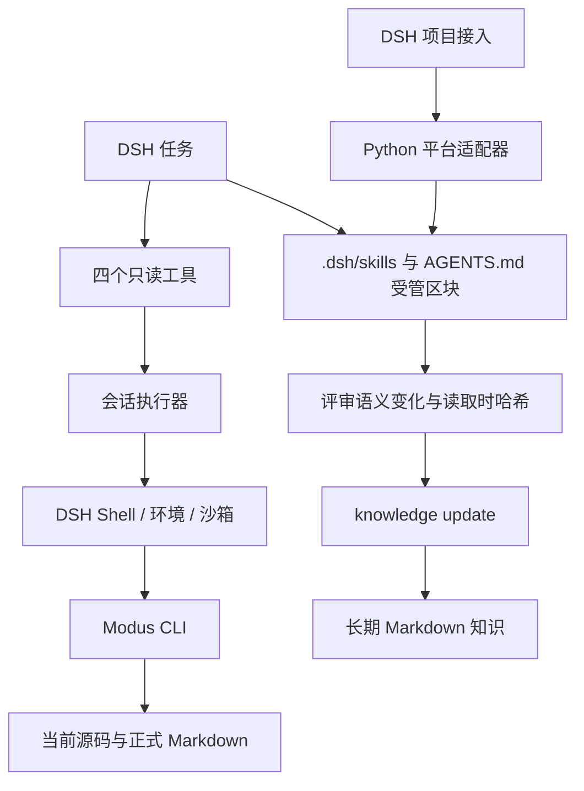

# DSH 集成设计

`@modus-ai/modus` 是 Modus 的 DSH 原生插件，把项目知识接入 DSH 的任务执行。设计围绕三个独立所有者展开：**Python 适配器管理项目接入，DSH 管理执行环境，Modus CLI 管理知识协议**。插件只做显式转换，不复制检索、核验或写入规则。

安装、配置和兼容范围见 [README](README.md)。本文说明源码职责、失败语义和贡献时需要验证的边界。

## 两条路径，共享一份知识



`modus init --platform dsh` 接入项目时复用既有安装事务、清单与卸载机制。运行时工具走 DSH Shell；模型确认长期语义变化后，再按共享 Skill 的 CAS 协议维护知识。四个工具不拥有写入能力，影响候选也不构成改写授权。

| 所有者 | 拥有的状态与决定 | 边界 |
| --- | --- | --- |
| `src/modus/platforms/dsh.py` | Skill 投影、与 Codex 共用的 `AGENTS.md` 中的 `modus` 指引区块 | 复用安装生命周期；不修改 DSH profile |
| DSH profile / Cordis | 插件配置、工具和上下文注册 | 加载、卸载与服务生命周期由宿主管理 |
| DSH 执行服务 | 会话目录、环境、取消、超时与沙箱 | 项目 I/O 发生在会话的执行环境 |
| Modus CLI | 检索、影响候选、核验与 CAS 写入规则 | TypeScript 不维护第二套业务判断 |
| 用户与共享 Skill | 初始化授权、语义评审、人工内容保护 | `clean` 不能代替事实回读或任务测试 |

## 源码阅读顺序

TypeScript 源码位于仓库的 `integrations/dsh/src/`。按一次调用的路径阅读即可，不需要先理解整个 Python 工程。

| 文件 | 职责 | 修改时机 |
| --- | --- | --- |
| `index.ts` | Cordis 组合入口，声明依赖并注册能力 | 宿主服务或插件生命周期变化 |
| `config.ts` | 激活时验证配置，生成只读快照 | 可执行文件规则或资源限制变化 |
| `tools.ts` | 工具参数、CLI 参数映射、可交付报告的退出码 | 新增工具或已有 CLI 契约变化 |
| `runner.ts` | 绑定当前会话，在 DSH Shell 中执行并检查完整性 | 取消、沙箱或执行环境契约变化 |
| `protocol.ts` | CLI 版本门槛、命令与报告类型、JSON 解码 | CLI 协议版本或报告形状变化 |
| `guidance.ts` | 按需读取、维护流程与统一 CLI 路径的运行时指引 | 工作流入口或授权说明变化 |

工具声明依赖 `ModusRunner` 函数契约，不直接访问 Shell。协议模块不依赖 Cordis 或会话状态。组合入口绑定这些具体实现；当前只有一种执行方式，无需再引入执行器注册表或通用插件框架。

Python 的 `DshAdapter` 只声明布局与渲染差异。Codex 与 DSH 通过 `render_agents_instructions` 渲染同一份指引，清单按文件路径和标记记录一份共享区块；卸载时最后一个使用它的平台负责删除。Claude 与 DSH 已验证共享相同的两个调用权限字段，因此复用 `render_invocation_metadata`；其他平台继续由自己的适配器决定投影方式。

## 一次工具调用

1. DSH 根据工具声明验证模型参数。执行器检查会话、项目根参数及 NUL 字符，在任何 Shell 调用前完成参数引用。
2. 从 `workingDirectory`、`shellEnv`、`sandboxPolicy` 取得本次执行上下文。Shell 启用沙箱却没有策略服务时，调用失败。
3. 在同一执行环境执行 `executable --version`。版本不兼容或执行失败时，不启动业务命令。
4. 执行 `executable -C root …`，传递同一取消信号、目录、环境与沙箱策略。超时策略为 `kill`；工具等待执行服务返回进程结果后再结束。
5. 确认执行完整、退出码属于该工具的报告范围，再解析 JSON 对象，返回 `{ exitCode, result }`。

每次调用都检查版本，因为会话可以切换目录与执行后端。宿主进程中缓存一次版本会把一个环境的兼容性错误地带到另一个环境。

每个参数独立进行 Bash 单引号引用。位置查询使用 `--` 结束选项，路径选项使用 `--path=value` 等形式；引用阻止 Shell 展开，选项边界防止以 `-` 开头的业务文本成为 CLI 参数。`root` 可相对会话目录；可执行文件必须是程序名或 Bash 绝对路径，避免切换项目后解析到不同程序。

## 报告与失败各有语义

| 结果 | 插件行为 | 调用方责任 |
| --- | --- | --- |
| 完整报告，退出码 `0` | 保留完整 JSON 与退出码 | 根据报告内容判断下一步 |
| 影响检查退出码 `1` | 交付候选、冲突和验证状态 | 回读候选及冲突，不推定可以写入 |
| 知识核验退出码 `4` | 交付全部 findings | 处理发现项，不把工具返回当成核验通过 |
| 其他退出码 | 工具失败，保留退出码与 CLI 诊断 | 排查命令、版本与执行环境 |
| 取消、超时、信号终止、沙箱失败、stdout 截断 | 工具失败，不交付部分证据 | 处理原因后重新调用 |
| 非法 JSON、非对象结果、非有限数值 | 工具失败；解析异常保留原因 | 检查 CLI 协议与输出 |

`reportExitCodes` 在各工具旁显式声明，不能在执行器中全局放行 `1` 或 `4`。版本探测只接受 `0`。资源上限按进程计算：一次工具调用包含版本检查和业务命令两个进程，各自受 `timeoutMs` 与 `maxOutputBytes` 约束。

## 扩展时保持的约束

新增只读工具时，在 `tools.ts` 声明参数、CLI 映射和报告退出码，并补充真实 CLI 往返测试。业务判断仍由 Python 命令拥有；不要从原生插件扫描 Git 修改、推断任务归属或自动写知识。

新增宿主能力时，先核对 DSH 的实际服务接口与生命周期，再修改 `inject` 和执行边界。支持新的 DSH 版本需同时验证运行时与 peer 约束；当前两个预览版本的通过结果不能外推到其他版本。

修改共享 Skill 时，保持设计文档与随包参考一致。调用权限是模型与用户两条独立轴；初始化、重建的授权不能被工具描述或运行时指引放宽。

## 贡献与验证

在仓库根按 `CONTRIBUTING.md` 执行 Python 完整检查与 wheel 冒烟。然后在 `integrations/dsh/` 使用 Node.js 24：

```bash
npm ci --ignore-scripts
export MODUS_TEST_EXECUTABLE=/absolute/path/to/modus/.venv/bin/modus
npm test
npm run smoke:package
```

`smoke:package` 从当前源码构建并打包；要验收 npm 上已发布的精确版本，另行运行：

```bash
npm run smoke:registry -- @modus-ai/modus@1.0.0
```

两条入口共用隔离安装和行为检查。registry 模式从官方 npm 仓库获取指定版本，不会用本地构建替换它；输出记录实际包标识、来源、完整性摘要和 CLI 验证状态。隔离清单和锁文件保留宿主的精确版本，只补入待验 tarball 的完整性摘要及归档内的依赖声明；一次 `npm ci --offline` 完成安装，再用 `npm ls --all` 拒绝缺失或不兼容的依赖。宿主 tarball 来自前置 `npm ci` 填充的同一缓存，验收不依赖历史包元数据，不触碰用户的 DSH profile。

| 验证入口 | 证明的行为 |
| --- | --- |
| `test/protocol.test.mjs` | 配置边界、版本门槛与报告解码 |
| `test/plugin.test.mjs` | 官方 Cordis 注册与释放、参数校验、会话隔离、执行失败和业务退出码 |
| `test/cli.test.mjs` | 四个工具调用真实 CLI；只读调用保留项目字节，CAS 更新可被再次检索，过期摘要和非法路径拒绝写入 |
| `test/package-profile.test.mjs` | 空缓存下离线安装真实 tarball，保持锁文件不变，并拒绝插件与宿主的 peer 不兼容组合 |
| `test/support/` | 复用官方 Cordis 生命周期与参数校验；隔离样例、Bash 进程和字节快照只属于测试环境 |
| `scripts/package-smoke.mjs` | 检查本地或 registry tarball 的交付内容，隔离安装后通过包的公开入口运行同一组消费者测试 |
| `scripts/verify-installed.mjs` | 从隔离产物加载 DSH patch、注册并释放工具 |
| 仓库 `tests/test_dsh.py` | Skill 权限、幂等、Codex 共存、升级保护与卸载保留 |

未设置 `MODUS_TEST_EXECUTABLE` 时，真实 CLI 测试会跳过；CI 的源码测试和分发测试都必须显式提供。可将它指向隔离安装的 wheel 中的 `modus`，同时验收 Python 与 npm 两个分发边界。设置 `MODUS_KEEP_SMOKE_ARTIFACTS=1` 可保留临时验收目录；产物和运行记录不提交到仓库。

消费者测试通过 `@modus-ai/modus` 的公开入口加载插件。在源码目录中解析到本包，在隔离目录中只解析到安装后的包；测试不会复制实现文件补齐缺失产物。测试中的子进程只用于构造真实 CLI 执行环境，插件生产代码始终通过 DSH Shell。自动化测试覆盖执行协议；模型能否正确理解证据、判断语义变化并维护知识，需要在独立样例项目中验证。

### 使用已安装的 DSH 运行时

默认测试使用锁文件中的 DSH 依赖。验证另一版已安装宿主时，可使用 `test/runtime-resolver.mjs` 将 `@deepseek-ai/` 导入导向该运行时。macOS 桌面版使用其内置 Electron 读取 ASAR 模块：

```bash
dsh_app_contents='/Applications/DeepSeek Harness.app/Contents'
ELECTRON_RUN_AS_NODE=1 \
MODUS_DSH_RUNTIME_ANCHOR="$dsh_app_contents/Resources/app.asar/dsh/node_modules/@deepseek-ai/dsh/lib/bin.js" \
MODUS_TEST_EXECUTABLE=/absolute/path/to/modus/.venv/bin/modus \
"$dsh_app_contents/MacOS/DeepSeek Harness" \
  --expose-internals --import ./test/runtime-resolver.mjs \
  --test --test-isolation=none test/*.test.mjs
```

解析钩子只影响测试进程，不修改应用安装目录。宿主需提供 Node.js 模块钩子；不要通过普通 Node 直接加载 Electron ASAR。扩大兼容范围时，需要同时验证各版本运行时和真实 CLI 调用。

### 分发边界

Python CLI 与 npm 插件独立版本化。修改后从确定的源码提交构建，执行仓库检查、插件测试和隔离安装，再对最终 tarball 计算摘要。发布说明记录版本、源码提交、兼容范围和实际验证范围，临时调试过程与逐次验收记录不进入产品文档。

npm 包仅交付预构建 `lib/`、bundle patch、包元数据、许可证、安装说明与集成设计。Python 源码包还保留插件源码、测试和构建入口，供贡献者复现。用户安装不依赖 TypeScript 编译或安装脚本。

发布前重新执行依赖审计；上游 DSH 依赖存在未解决告警时，应记录对应版本与处理结论，并在升级后重新验证兼容性。审计结果与测试数量属于具体版本的验证证据，不在长期指南中写成固定状态。

稳定版本使用 npm 的 `latest` 标签；预览版本使用 `alpha` 标签。Release 与 npm 应使用同一份已验证 tarball；发布说明应给出包含 DSH adapter 的 CLI 安装来源。仅满足 CLI 协议版本范围，不代表每个历史版本都包含平台适配器。
