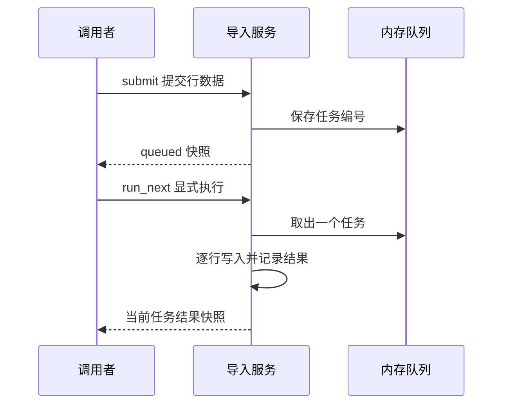
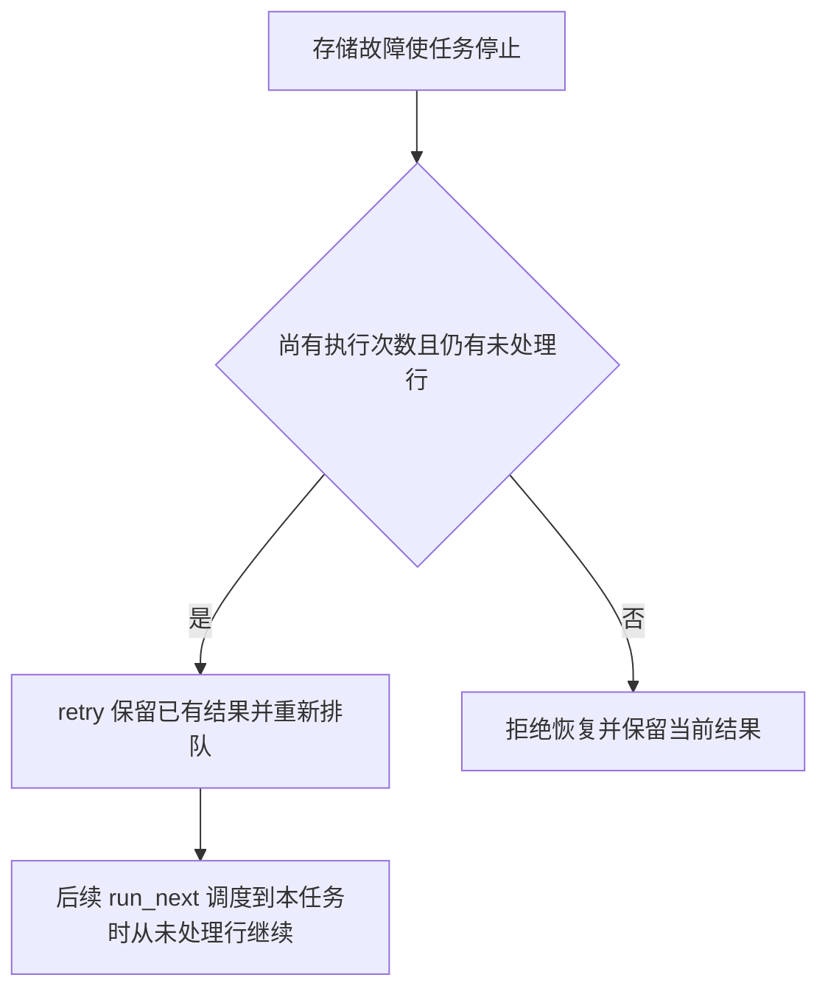

# 写作样例与成对反例

这些片段用于学习组织信息，不是待填模板。预约与联系人导入均为明确的教学项目，下面的人名、时间和邮箱均为示例数据，不代表当前项目或 Modus 的业务事实。实际创作以项目证据为准，不照搬示例的接口、字段、状态或能力。

维护者完整样稿编号为 `simple-reservation` 与 `async-import`，位于源码仓库的 authoring fixtures 中；每套包含教学实现、事实说明、预设读者任务和完整 Domain/六专题/Module。安装后的作者只需要本页自包含片段，不依赖源码仓库的测试目录。维护者修改片段时应核对同编号样稿的事实；样稿不是发布评分标准。

按当前问题选读，不要求每次加载全部示例：

| 编辑问题 | 片段 |
| --- | --- |
| 契约族有总览，但方法和成员被汇总掉 | [从契约族到逐项详情](#从契约族到逐项详情) |
| 一页只有简略步骤，缺少因果 | [从清单到场景](#从清单到场景) |
| 字段表很宽但业务含义仍不清楚 | [宽表与字段解释](#宽表与字段解释) |
| 成功响应被当作全部完成 | [受理与完成](#受理与完成) |
| 图塞入全部参与者和失败分支 | [复杂图的拆分](#复杂图的拆分) |
| 重试描述没有前提和残留 | [恢复的条件与结果](#恢复的条件与结果) |
| 模块重复专题，或只有跳转链接 | [主定义与场景上下文](#主定义与场景上下文) |

## 从契约族到逐项详情

对应 `async-import` 的四个公开入口；以下清单只是该教学项目的范围，不能套用到其他项目。

**问题稿：**“ContactImporter 提供提交、查询、执行和重试能力。入参为租户、任务和联系人数据，返回任务状态与统计。字段详见对象专题。”对象专题又只写“身份字段、过程字段和结果字段”。

**改进方式：**总览分别指向 `submit`、`query`、`run_next`、`retry` 四个详情。共用任务快照在对象专题定义一次，但四个入口各自说明参数、处理和返回时点。`run_next` 没有租户或任务号参数，`query` 不推进任务，`retry` 只重新排队；不能用一段“处理任务并返回”合并这些差异。

对任务快照逐项核对 `job_id`、`status`、`total`、`processed`、`written`、`rejected`、`attempts`、`retryable`、`error`、`results`；`results` 的元素再指向 `row_index`、`email`、`outcome`、`reason` 的完整定义。这里列的是需要落到字典的成员身份，清单本身还不是字段说明。

例如把容易被一句带过的 `retryable` 就地展开：

| 取值/变化 | 业务含义 |
| --- | --- |
| 初始 `false` | 新任务尚未发生可恢复存储故障 |
| 存储故障后为 `true` | 当前执行次数尚小于 2，允许显式重新排队 |
| `retry` 后为 `false` | 本次恢复已经受理，不能重复追加队列 |
| 第二次故障后为 `false` | 恢复预算耗尽，原任务不能再排队 |

这个标记不是“是否执行成功”。全部行被拒绝时任务同样为 `failed`，但不可重试；`retry` 还会检查任务是否为失败状态。用示例说明：第 1 次执行在第 2 行前中断，标记为真；调用 `retry` 后标记变假、状态回到 `queued`，已处理行保留，次数仍为 1。再次执行才增加次数并继续剩余行。

**改进原因：**入口清单防止漏方法，成员清单防止共享字典只有字段组；字段详情和案例让读者知道某个值改变了什么。排版用小表保留精度，邻近段落解释条件关系，不把所有字段塞进一张宽表。

## 从清单到场景

对应 `simple-reservation` 的创建预约场景。

**问题稿：**“校验参数，检查会议室，创建预约，返回结果。失败时检查参数。”

这段话没有说明参数如何改变判断、冲突发生在何时、返回代表什么；即使改成四个项目符号也没有增加信息。

**改进稿：**林青要为 4 人安排会议，选择容量为 6 人的 A201，提交 2026 年 11 月 5 日 09:00—10:00（UTC+08:00）。这是示例数据。预约入口先核对文本、会议室、人数和时间，再检查同一会议室已确认预约的时间重叠；全部检查通过后才生成编号并写入当前服务实例。

1. 输入时间必须带时区，保存时转换为 UTC；本例保存为 01:00—02:00 UTC。
2. 冲突按左闭右开的区间判断，因此另一个预约从 10:00 开始不与本例冲突，09:30 开始则与本例重叠；仍需检查其他已有预约。
3. 返回 `confirmed` 表示本次同步创建已完成。该教学实现只保存内存记录，返回成功不意味着进程重启后仍能查到它。

冲突检查失败时不会新建预约。创建入口没有请求幂等键，调用者不能把“再次提交相同时间”当成安全获取原结果的方式。

**改进原因：**正文解释了目标与过程，步骤承载具体判断；增加的是时间、冲突、写入和完成信息，而非同义扩写。完整错误字典仍由接口专题定义。

## 宽表与字段解释

对应 `simple-reservation` 的 Reservation 字段说明。

**问题稿：**把字段、类型、默认、来源、写入方、约束、示例、异常和关联接口放进九列表，每个单元格再写一整段。或者只写“status：str，预约状态”。

**改进稿：**先查基础含义，再查变化约束；两张表都保留字段标识。

| 字段 | 类型 | 业务含义 |
| --- | --- | --- |
| `status` | 字符串 | 当前预约是否仍占用会议室时间段 |
| `cancel_reason` | 字符串或空值 | 首次有效取消时记录的原因 |

| 字段 | 初始值 | 变化与约束 |
| --- | --- | --- |
| `status` | `confirmed` | 取消成功后变成 `cancelled`，没有恢复入口 |
| `cancel_reason` | `None` | 首次取消写入；有效重复取消保留原原因 |

已取消预约不再参与时间冲突检查，但记录仍留在当前服务实例。返回对象是不可变快照：取消之前保存的创建结果不会自动变成 `cancelled`，调用方应使用取消入口返回的新快照更新显示。

**改进原因：**拆表减小阅读宽度，正文补充字段之间的业务关系；仍然保留精确值和例外。完整样稿覆盖所有字段，这个片段只演示两项的表达方式。

## 受理与完成

对应 `async-import` 的提交与查询场景。

**问题稿：**“调用 submit 导入联系人，成功后返回任务编号。接口支持幂等和重试。”

**改进稿：**`submit` 返回任务快照，首次提交的状态为 `queued`。这表示输入已经通过接收校验并进入本实例队列，联系人尚未写入。教学项目没有后台线程，演示者必须显式调用 `run_next` 才会执行排队任务；查询本身不会推进处理。

| 查询信息 | 可以得出的结论 |
| --- | --- |
| `queued` | 等待一次显式执行，不能按联系人已导入处理 |
| `succeeded` | 全部行都成功写入 |
| `partial` | 全部行已有结果，既有写入也有拒绝 |
| `failed` | 结合 `error`、`processed` 和 `retryable` 判断是全部拒绝还是执行中断 |

例如提交三行示例数据，其中两行有效、一行邮箱无效。执行完毕后 `processed=3`、`written=2`、`rejected=1`，状态为 `partial`。这次批次已经结束，不能用恢复入口重新处理那条被拒绝的行；应修正输入后用新的幂等键提交新任务。

同租户、同幂等键、相同原始载荷会返回原任务的当前快照，不再次排队；更换载荷会被拒绝。这个范围不等同于跨进程持久幂等或所有操作都能重试。

**改进原因：**调用结果、任务结果与恢复资格分别解释，读者能据此决定下一步，而非被“成功”“支持重试”两个词误导。

## 复杂图的拆分

对应 `async-import` 的执行与恢复场景。

**问题稿：**一张图同时放调用者、任务队列、每个对象字段、所有状态、每条校验规则和恢复循环，再把字体缩小以容纳全部内容。

**改进稿：**先用一张短时序图说明提交与处理的交接；只展示首次提交并顺序执行的主线，行级判断和恢复由后续局部图解释。

这里的队列是同一进程的内存对象，图中的参与者分栏不表示独立进程或真实消息中间件。`run_next` 返回前完成本次处理；第一次 `submit` 返回时尚未处理。

恢复局部图只回答“执行中断后哪些记录会被保留”。

完整状态定义放在状态专题，故障注入和恢复次数的精确条件放在接口与规则专题。两张图回答不同问题，不是同一机制的两份完整主图。

**改进原因：**主线和恢复各自可读，图外文字承担部署边界及详细条件。是否真正清晰仍需在目标阅读器中预览，不能凭 Mermaid 围栏宣称通过。

## 恢复的条件与结果

对应 `async-import` 的存储故障恢复。

**问题稿：**“失败任务可重试，系统自动恢复，保证不重复。”

**改进稿：**只有因 `storage_unavailable` 中断、仍有未处理行且 `attempts < 2` 的任务可以恢复。这个教学实现需要调用者显式调用 `retry`，不会自动调度恢复；`retry` 成功只重新排队，不代表未完成的联系人已经写入。

例如一个包含三行有效输入的新任务，在首次执行到下标 1 的行之前中断。第 0 行已经写入，其结果和联系人都保留，`processed=1`。恢复后，任务进入队尾；后续 `run_next` 调度到它时从下标 1 开始，而不是回到第 0 行。执行次数在 `run_next` 中增加，重新排队本身不增加次数；第二次执行再次中断后，恢复预算耗尽。

`partial` 或全部行被拒绝的任务已经完成逐行判断，不能走这个恢复入口。进程重启会丢失内存状态，教学实现没有崩溃恢复保证。

**改进原因：**恢复资格、触发方式、保留结果、继续位置和完成信号都可判定；没有将一次代码路径扩大成笼统的可靠性承诺。

## 主定义与场景上下文

对应 `simple-reservation` 的取消预约场景。

**问题稿一：**模块、对象和状态专题各复制一份完整字段字典与状态图。修改取消规则时，三处很容易出现不同解释。

**问题稿二：**模块只有“取消规则详见状态专题”，读者无法在当前页理解一次操作。

**改进稿：**取消模块就地解释：调用者提交当前实例中的预约编号和非空原因。首次取消把状态改为 `cancelled` 并记录原因，同步返回新快照；后续有效的重复取消返回首次取消结果，不覆盖原因。取消后同一时间段可以再次预约，取消前持有的旧快照不会自动更新。

然后精确链接状态专题的合法迁移和对象专题的完整字段定义。在正式项目中使用真实知识链接；本片段不伪造不存在的链接目标。

**改进原因：**模块保留本次操作所需的前提、结果和常见误解，专题继续拥有完整定义。去重以事实职责为边界，不以删除所有重复词句为目标。
