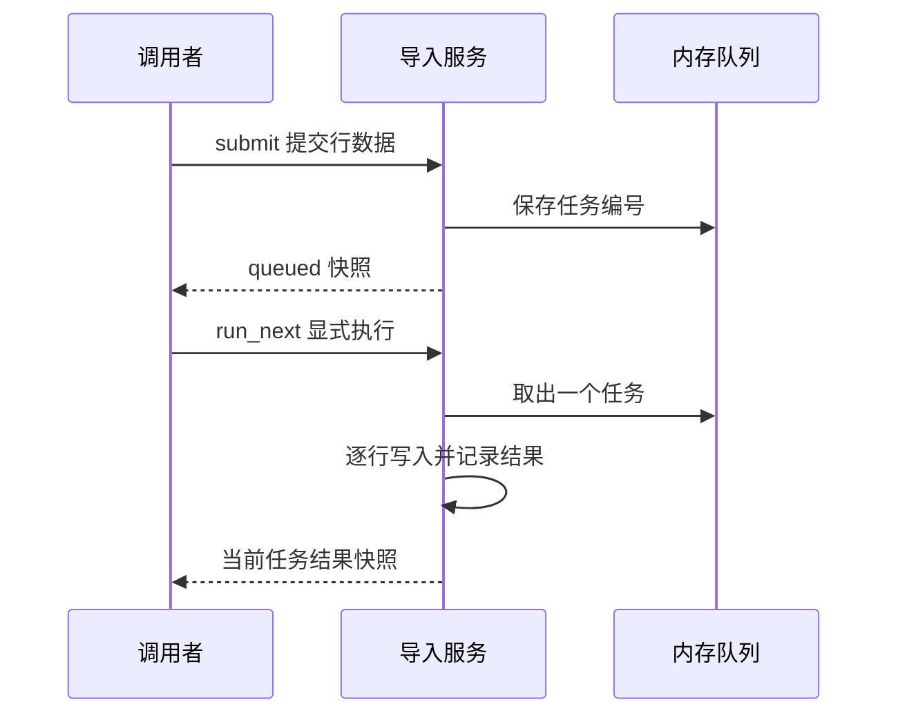
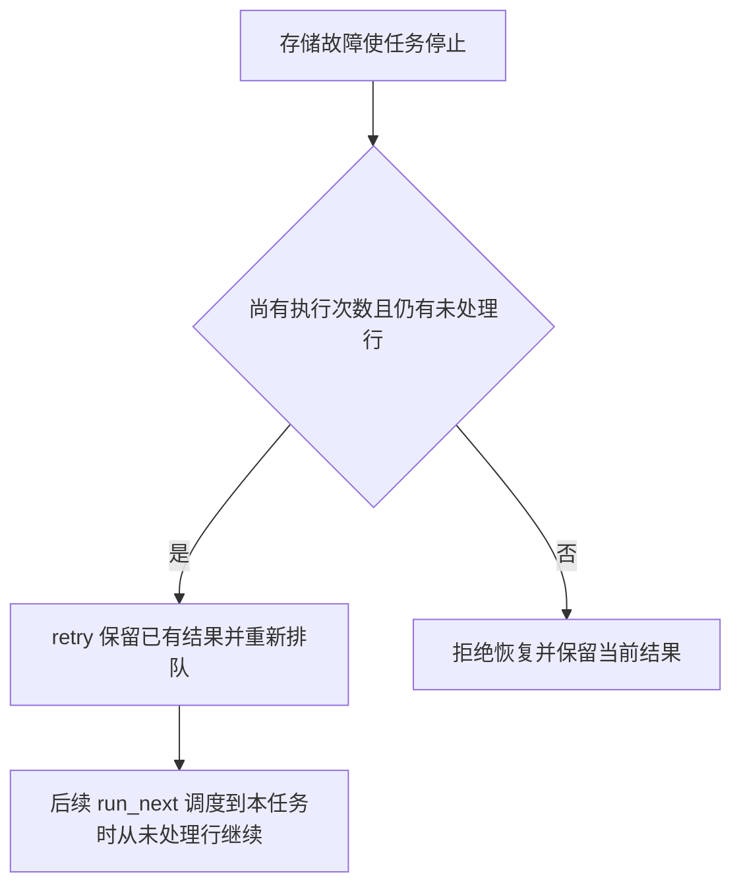

# 写作样例与成对反例

这些片段用于学习组织信息，不是待填模板。联系人导入是独立教学项目，下面的联系人代号、租户和邮箱均为合成示例数据，不代表当前项目或 Modus 的业务事实。实际创作以项目证据为准，不照搬示例的接口、字段、状态或能力。

维护者只维护一套完整样稿 `async-import`，位于源码仓库的 authoring fixtures 中；它包含教学实现、事实说明、预设读者任务和完整 Domain/六专题/Module。安装后的作者只需要本页自包含片段，不依赖源码仓库的测试目录。维护者修改片段时应核对同编号样稿的事实；样稿不是发布评分标准。

按当前问题选读，不要求每次加载全部示例：

| 编辑问题 | 片段 |
| --- | --- |
| 契约族有总览，但方法和成员被汇总掉 | [从契约族到逐项详情](#从契约族到逐项详情) |
| 一页只有简略步骤，缺少因果 | [从清单到场景](#从清单到场景) |
| 字段表很宽但业务含义仍不清楚 | [宽表与字段解释](#宽表与字段解释) |
| 成功响应被当作全部完成 | [受理与完成](#受理与完成) |
| 图塞入全部参与者和失败分支 | [复杂图的拆分](#复杂图的拆分) |
| 重试描述没有前提和残留 | [恢复的条件与结果](#恢复的条件与结果) |
| 模块重复专题，或只有跳转链接 | [主定义与场景上下文](#主定义与场景上下文) |
| 机器线索已读，正文仍只有名称或同一段流程 | [同一事实进入不同正文](#同一事实进入不同正文) |

## 从契约族到逐项详情

对应 `async-import` 的四个公开入口；以下清单只是该教学项目的范围，不能套用到其他项目。

**问题稿**：“ContactImporter 提供提交、查询、执行和重试能力。入参为租户、任务和联系人数据，返回任务状态与统计。字段详见对象专题。”对象专题又只写“身份字段、过程字段和结果字段”。

**改进方式**：总览分别指向 `submit`、`query`、`run_next`、`retry` 四个详情。共用任务快照在对象专题定义一次，但四个入口各自说明参数、处理和返回时点。`run_next` 没有租户或任务号参数，`query` 不推进任务，`retry` 只重新排队；不能用一段“处理任务并返回”合并这些差异。

对任务快照逐项核对 `job_id`、`status`、`total`、`processed`、`written`、`rejected`、`attempts`、`retryable`、`error`、`results`；`results` 的元素再指向 `row_index`、`email`、`outcome`、`reason` 的完整定义。这里列的是需要落到字典的成员身份，清单本身还不是字段说明。

例如把容易被一句带过的 `retryable` 就地展开：

| 取值/变化 | 业务含义 |
| --- | --- |
| 初始 `false` | 新任务尚未发生可恢复存储故障 |
| 存储故障后为 `true` | 当前执行次数尚小于 2，允许显式重新排队 |
| `retry` 后为 `false` | 本次恢复已经受理，不能重复追加队列 |
| 第二次故障后为 `false` | 恢复预算耗尽，原任务不能再排队 |

这个标记不是“是否执行成功”。全部行被拒绝时任务同样为 `failed`，但不可重试；`retry` 还会检查任务是否为失败状态。用示例说明：第 1 次执行在第 2 行前中断，标记为真；调用 `retry` 后标记变假、状态回到 `queued`，已处理行保留，次数仍为 1。再次执行才增加次数并继续剩余行。

**改进原因**：入口清单防止漏方法，成员清单防止共享字典只有字段组；字段详情和案例让读者知道某个值改变了什么。排版用小表保留精度，邻近段落解释条件关系，不把所有字段塞进一张宽表。

## 从清单到场景

对应 `async-import` 的坏行修正场景。

**问题稿**：“提交数据，执行任务，查看结果，失败时重试。”

这段话没有说明输入如何改变判断、失败发生在哪个阶段、返回代表什么；即使改成四个项目符号也没有增加信息。

**改进稿**：运营者要录入联系人甲和乙，用第三行更新甲的姓名。这是示例数据。三行都具有字符串姓名与邮箱，第二行邮箱为 `bad-address`。提交通过结构检查后返回等待快照，调度者显式执行才发生逐行判断。

1. 第一行创建甲；第二行因邮箱无效被拒绝，但不阻止第三行更新甲。全部处理后为 `partial`，写入 2 行、拒绝 1 行，实际只有一个联系人。
2. 提交者用 `row_index=1` 定位原始第二行，把邮箱修正为 `beta@example.test`，用新键提交这一行；原键绑定旧载荷，不能覆盖。
3. 调度者执行新任务，查询确认新任务为 `succeeded`、写入数为 1。旧任务仍为 `partial`，修正完成不改写旧批次历史。

部分成功已经完成原批次的逐行检查，不能调用 `retry` 重做坏行。修正输入是新请求，有条件恢复则用于特定存储故障。

**改进原因**：正文把用户目标、两次请求、数据变化和完成信号串起来；增加的是可执行的业务判断。完整错误字典仍由接口专题定义。

## 宽表与字段解释

对应 `async-import` 的任务字段说明。

**问题稿**：把字段、类型、默认、来源、写入方、约束、示例、异常和关联接口放进九列表，每个单元格再写一整段。或者只写“status：str，任务状态”。

**改进稿**：先查基础含义，再查变化约束；两张表都保留字段标识。

| 字段 | 类型 | 业务含义 |
| --- | --- | --- |
| `status` | 字符串 | 当前处于等待、执行还是业务终结或故障停止阶段 |
| `attempts` | 整数 | 实际出队执行的次数，包含首次执行 |

| 字段 | 初始值 | 变化与约束 |
| --- | --- | --- |
| `status` | `queued` | 显式执行转为 `running`；结果决定终结状态，可恢复失败经重排返回 `queued` |
| `attempts` | `0` | 每次出队加一，重新排队和查询不增加，恢复不清零 |

恢复后的等待任务可能已经写过部分联系人，不能从 `queued` 推断处理数必为零。响应是深拷贝快照；旧响应不会随执行更新，调用方需再次查询。

**改进原因**：拆表减小阅读宽度，正文补充字段之间的业务关系；仍然保留精确值和例外。完整样稿覆盖所有字段，这个片段只演示两项的表达方式。

## 受理与完成

对应 `async-import` 的提交与查询场景。

**问题稿**：“调用 submit 导入联系人，成功后返回任务编号。接口支持幂等和重试。”

**改进稿**：`submit` 返回任务快照，首次提交的状态为 `queued`。这表示输入已经通过接收校验并进入本实例队列，联系人尚未写入。教学项目没有后台线程，演示者必须显式调用 `run_next` 才会执行排队任务；查询本身不会推进处理。

| 查询信息 | 可以得出的结论 |
| --- | --- |
| `queued` | 等待一次显式执行，不能按联系人已导入处理 |
| `succeeded` | 全部行都成功写入 |
| `partial` | 全部行已有结果，既有写入也有拒绝 |
| `failed` | 结合 `error`、`processed` 和 `retryable` 判断是全部拒绝还是执行中断 |

例如提交三行示例数据，其中两行有效、一行邮箱无效。执行完毕后 `processed=3`、`written=2`、`rejected=1`，状态为 `partial`。这次批次已经结束，不能用恢复入口重新处理那条被拒绝的行；应修正输入后用新的幂等键提交新任务。

同租户、同幂等键、相同原始载荷会返回原任务的当前快照，不再次排队；更换载荷会被拒绝。这个范围不等同于跨进程持久幂等或所有操作都能重试。

**改进原因**：调用结果、任务结果与恢复资格分别解释，读者能据此决定下一步，而非被“成功”“支持重试”两个词误导。

## 复杂图的拆分

对应 `async-import` 的执行与恢复场景。

**问题稿**：一张图同时放调用者、任务队列、每个对象字段、所有状态、每条校验规则和恢复循环，再把字体缩小以容纳全部内容。

**改进稿**：先用一张短时序图说明提交与处理的交接；只展示首次提交并顺序执行的主线，行级判断和恢复由后续局部图解释。

这里的队列是同一进程的内存对象，图中的参与者分栏不表示独立进程或真实消息中间件。`run_next` 返回前完成本次处理；第一次 `submit` 返回时尚未处理。

恢复局部图只回答“执行中断后哪些记录会被保留”。

完整状态定义放在状态专题，故障注入和恢复次数的精确条件放在接口与规则专题。两张图回答不同问题，不是同一机制的两份完整主图。

**改进原因**：主线和恢复各自可读，图外文字承担部署边界及详细条件。是否真正清晰仍需在目标阅读器中预览，不能凭 Mermaid 围栏宣称通过。

## 恢复的条件与结果

对应 `async-import` 的存储故障恢复。

**问题稿**：“失败任务可重试，系统自动恢复，保证不重复。”

**改进稿**：只有因 `storage_unavailable` 中断、仍有未处理行且 `attempts < 2` 的任务可以恢复。这个教学实现需要调用者显式调用 `retry`，不会自动调度恢复；`retry` 成功只重新排队，不代表未完成的联系人已经写入。

例如一个包含三行有效输入的新任务，在首次执行到下标 1 的行之前中断。第 0 行已经写入，其结果和联系人都保留，`processed=1`。恢复后，任务进入队尾；后续 `run_next` 调度到它时从下标 1 开始，而不是回到第 0 行。执行次数在 `run_next` 中增加，重新排队本身不增加次数；第二次执行再次中断后，恢复预算耗尽。

`partial` 或全部行被拒绝的任务已经完成逐行判断，不能走这个恢复入口。进程重启会丢失内存状态，教学实现没有崩溃恢复保证。

**改进原因**：恢复资格、触发方式、保留结果、继续位置和完成信号都可判定；没有将一次代码路径扩大成笼统的可靠性承诺。

## 主定义与场景上下文

对应 `async-import` 的故障恢复场景。

**问题稿一**：模块、对象和状态专题各复制一份完整字段字典与状态图。修改恢复条件时，三处很容易出现不同解释。

**问题稿二**：模块只有“恢复规则详见状态专题”，读者无法在当前页理解一次操作。

**改进稿**：执行模块就地解释：第一次执行在第二行前因模拟故障停止，调用者先查询同租户任务，确认状态失败且允许恢复，再调用 `retry`。此时第一行联系人和结果保留，任务追加到队尾，执行次数仍为 1；调度者再次执行到它才处理第二行。没有新故障且两行有效时，最终成功，次数为 2。

然后精确链接状态专题的合法迁移和对象专题的完整字段定义。在正式项目中使用真实知识链接；本片段不伪造不存在的链接目标。

**改进原因**：模块保留本次操作所需的前提、结果和常见误解，专题继续拥有完整定义。去重以事实职责为边界，不以删除所有重复词句为目标。

## 同一事实进入不同正文

对应 `async-import` 的执行与恢复。机器可能定位入口、写入或状态相关区域，具体交付随语言和提供方而异；这些线索本身不说明恢复起点、执行次数和保留字段。作者回读 `run_next`、`retry`、`_view` 及相关声明后，再形成以下已核验事实。

**示例数据与实际推演**：一个全新服务实例接收两行有效联系人，第一次 `run_next(fail_before_row=1)` 在下标 1 的行处理前中断。此时状态为失败（`failed`），`processed=1`、`written=1`、`attempts=1`、`retryable=true`；第一行联系人及结果仍在内存中。`retry` 检查同租户任务存在、状态为失败且可恢复，然后只把任务重新排队，清空错误并关闭恢复标记。它保留已处理结果和执行次数，不在本次调用处理第二行。

| 正文落点 | 从同一事实中写出什么 |
| --- | --- |
| API：`retry` 详情 | 两个身份参数、同租户查找与恢复守卫；返回排队快照，`processed=1`、`attempts=1`、`retryable=false`。再次立即调用被拒绝，不能把受理写成恢复完成 |
| Object：任务与快照 | `processed` 从结果数派生，`written` 统计写入行而非独立联系人；`attempts` 由执行入口增加，`retryable` 控制能否重新排队；快照是深拷贝 |
| Rule：恢复资格 | 实际检查是失败状态和恢复标记；该标记在模拟存储中断且次数未达 2 时为真。全部行被拒绝也可为失败状态，却没有恢复资格 |
| State：失败到排队 | 重新排队不是最终成功。下一次实际执行才增加次数，从未处理行继续；图和转换表保留失败、排队、执行及各终态的区别 |
| Downstream：执行交接 | 调用者显式驱动本实例队列；没有后台消费者。再次 `run_next` 调度到该任务时才处理第二行，查询不推进任务 |
| Infrastructure：内存生命周期 | 任务、结果、联系人和队列属于当前实例；没有跨进程持久恢复。故障注入发生在行前，不代表已经覆盖写入后进度未存的故障窗口 |
| Module：操作案例 | 串联查看失败快照、判断恢复资格、重新排队、再次执行、查询完成；两行处理结束后为成功（`succeeded`），`processed=2`、`written=2`、`attempts=2` |

**反例复核**：同租户正常调用 `retry` 后、尚未再次执行时重放 `retry`，状态已是排队且标记为假，因此抛出 `RetryNotAllowed`，不会多入队。第二次执行若再次存储中断，执行次数已达 2，不能继续恢复；已有行结果仍保留。模块应把这两个失败点放在相应操作旁，不能统一写成“失败后重试”。

**改进原因**：同一份调查支持不同读者问题，精确条件只在其主定义完整维护，其他页面保留本次判断需要的上下文。作者在该单元内立即核对参数、字段变化、图中阶段和案例结果，避免等全部专题写完后凭摘要重新构造模块。这个片段只示范一个场景的投影，完整交付仍须逐一覆盖其余接口、字段和场景。
