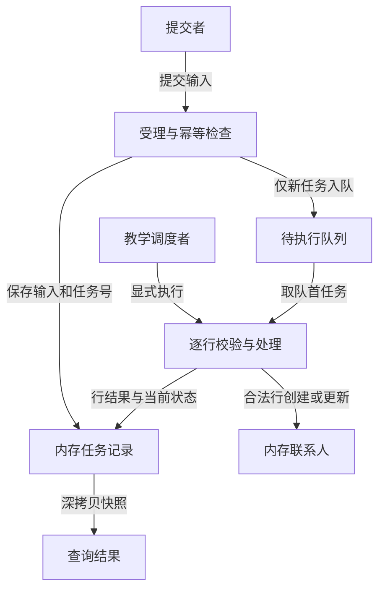

# 联系人导入教学系统概览

本系统帮助读者理解批量任务的受理、执行、部分成功与有条件恢复。提交者提供联系人行并查看结果，教学调度者显式执行队列；所有数据属于同一个 Python 实例。它没有真实网络服务、数据库、后台线程或身份认证，不能作为生产导入服务使用。

## 能力与阅读入口

| 能力 | 角色与目标 | 返回时已发生什么 | 手册 |
| --- | --- | --- | --- |
| 提交与查询 | 提交者建立批次、查看结果或修正坏行 | 受理保存输入并排队；查询只取快照 | [提交与查询](domain/contact-import/references/modules/submission-query.md) |
| 执行与恢复 | 教学调度者处理剩余行，提交者重排可恢复任务 | 执行可能完成或中断；重排尚未执行 | [执行与恢复](domain/contact-import/references/modules/execution-recovery.md) |

这两项属于同一个[联系人导入域](domain/contact-import/SKILL.md)，不是两个部署服务。完整契约、字段、判定、状态、协作和资源分别进入领域六专题；项目共享工程边界见[团队规范](constraint/team-standard.md)。

## 运行结构与责任交接

图中队列、任务记录和联系人都是实例内结构。箭头表示本例实际的数据交接，不表示网络请求或独立进程。

受理只写任务与队列，联系人由执行阶段修改；提交者主动查询取得新快照，反复查询不会推动队列。执行时的 `running` 是同步调用内部阶段，不证明存在可并发观察的后台执行。可恢复失败经 `retry` 回到队列，再由调度者显式执行；快照读取本身不触发恢复，条件见[状态与转换](domain/contact-import/references/state_machine.md)。

| 交接点 | 已成立的事实 | 下一责任与完成判断 |
| --- | --- | --- |
| 新请求返回 `queued` | 输入副本、任务及队列项已在当前实例保存 | 调度者调用 `run_next`，返回成功不代表联系人已写入 |
| 执行返回完成或中断快照 | 已处理行结果可查，可能存在拒绝行或中途故障 | 提交者结合状态、错误、计数和恢复资格判断下一动作 |
| 恢复返回 `queued` | 已有结果保留，任务重新排队 | 再次执行并查询；重排不是最终完成 |

调用输入与返回字段见[接口专题](domain/contact-import/references/api.md)，谁调用谁及错误交接见[协作专题](domain/contact-import/references/downstream.md)。

## 一次完整导入

以下为示例数据：提交三行，第一行为 `ALPHA@example.test`，第二行邮箱不合法，第三行为 `alpha@example.test` 且姓名更新。新实例受理后返回 `queued`，处理数为 0；此时还没有联系人。

显式执行后，第一行创建联系人，第二行被拒绝，第三行更新第一行对应的联系人。最终任务为 `partial`，`processed=3`、`written=2`、`rejected=1`，独立联系人只有 1 个。部分成功表示所有行已判定，不能用 `retry` 重做；修正坏行后使用新键提交新请求。字段口径与行级结果见[对象专题](domain/contact-import/references/object.md)。

若两行合法输入在第二行处理前遇到第一次模拟存储故障，第一行写入与结果保留。只有当前任务标记为可恢复时，提交者才能重排；再次执行从第二行继续。当前机制没有覆盖进程重启或任意写入中途失败，工程限制见[恢复边界](constraint/team-standard.md#恢复只覆盖已证明的故障窗口)。

## 开发与排障导航

| 问题 | 先核对什么 | 主定义 |
| --- | --- | --- |
| 一直排队 | 是否实际调用执行入口，是否使用同一实例 | [执行手册](domain/contact-import/references/modules/execution-recovery.md) |
| 同键提交冲突 | 原始字符串与行顺序是否变化，不能只比较归一化邮箱 | [幂等规则](domain/contact-import/references/rule.md#r2幂等键保护同一次请求不修改旧请求) |
| 失败后能否继续 | 错误类型、已处理行、尝试次数与恢复资格 | [状态专题](domain/contact-import/references/state_machine.md) |
| 新实例查不到旧任务 | 本例没有持久存储或重启恢复 | [资源边界](domain/contact-import/references/infrastructure.md) |
| 新增字段或改变故障处理 | 输入身份、公开快照和恢复游标是否仍一致 | [团队规范](constraint/team-standard.md#验证与演进) |

在教学项目目录运行 `python3 import_source.py` 可复核自带断言。更完整的阅读顺序和验收方法见[使用说明](../../README.md)与[读者任务](../../reader-tasks.md)。

## 依据与未实现范围

本概览消费六专题、两份模块手册和团队规范的主定义；精确源码位置由下层元数据承载。教学实现可以证明上述实例内行为，不能证明真实消息确认、数据库事务、部署拓扑、生产权限或可用性承诺。新增这些能力时，应先更新原始实现与对应主定义，再修订系统关系和规范适用范围。
