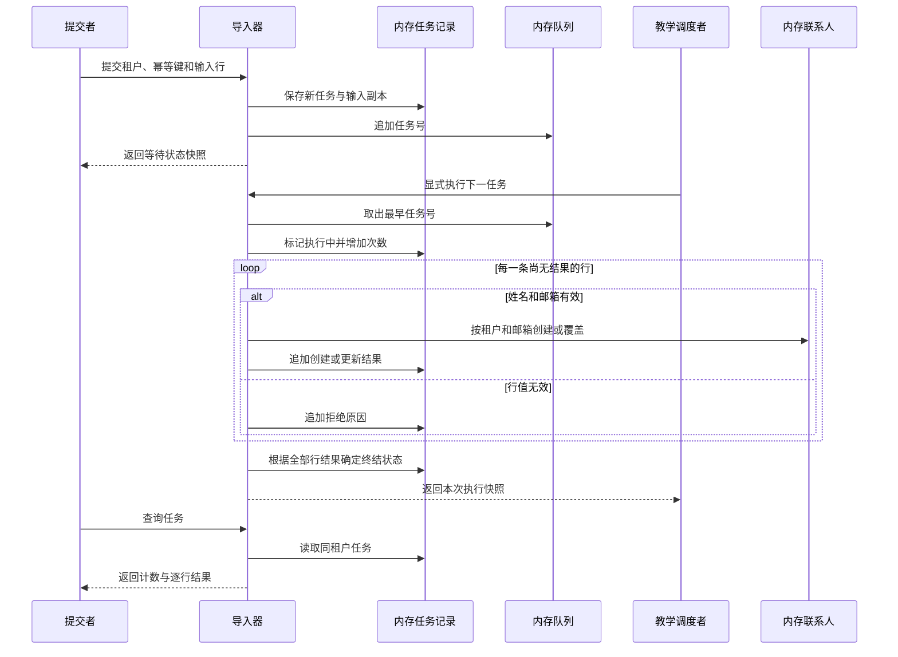

# 协作：一批联系人怎样从受理走到可查询结果

本教学项目没有外部下游系统。下面将同一对象内部的任务记录、队列和联系人记录按职责分开画，帮助读者识别交接时点；这些参与方不是独立进程、远端数据库或真实消息服务。

## 正常处理与逐行拒绝

图中受理响应发生在队列追加之后、任何联系人写入之前。执行由另一段显式调用触发；调用本身同步运行到完成或模拟故障。查询只是读取任务，不能代替执行。图省略了重复提交和故障分支，以便聚焦这条主链路；二者在下面单独解释。

| 交接点 | 传递什么 | 接收方怎样使用 |
| --- | --- | --- |
| 提交者到导入器 | 租户、幂等键、有序输入行 | 整体结构校验、幂等比较和输入副本保存 |
| 导入器到队列 | 任务号 | 维持待执行顺序；载荷留在任务记录中 |
| 执行器到联系人记录 | 原租户、归一化邮箱、去空白姓名 | 按业务键创建或覆盖当前值 |
| 执行器到任务记录 | 行下标、邮箱、处理结果和原因 | 累计进度、判断终结状态、确定恢复起点 |
| 查询结果到提交者 | 完成阶段、计数、逐行结果 | 展示进度、核对写入和整理需修正的行 |

## 重复提交为什么不会重复执行

同租户同键命中既有任务后，导入器比较载荷指纹。相同则直接读取当前快照，既不创建任务，也不追加队列；不同则返回幂等冲突。这个路径没有联系人交接。因此重复提交可以得到一个已经完成的结果，也可以得到尚未执行的结果。

若改用新键，即使数据与旧批次完全相同，也会创建新任务并排队。这是明确的幂等范围，不是队列去重失效。新任务再次写同邮箱时通常记录 `updated`，应按新请求的业务意图处理。

## 存储故障怎样暂停交接

只有教学调度者指定的绝对行下标命中本次尚未处理的行时，执行器才会在该行处理开始前触发模拟故障，停止后续行。下标越过总行数或指向此前已处理的行时，不会触发故障。先前交给联系人记录的有效行和追加到任务中的结果都保留；故障行还没有结果，也没有联系人写入。系统将任务标记为 `failed`，并依已执行次数设置是否允许恢复。

恢复调用只把任务号追加到队列尾部；若还有其他任务在等待，它们可能先执行。真正的下一次执行从已有结果数对应的位置继续，未重做前序行。这些行为依赖当前单进程内存模型，不提供跨服务投递确认、消费租约、重试退避或死信队列。

## 谁对失败负责

| 现象 | 当前负责动作 | 不应作出的推断 |
| --- | --- | --- |
| 提交结构不合法 | 提交者修正请求，重新提交 | 没有创建任务，不存在排队恢复 |
| 行邮箱不合法 | 提交者读取拒绝结果，改数据后建新任务 | 后续有效行仍可能已写入 |
| 任务始终等待 | 教学调度者显式执行下一任务 | 等待本身不是存储失败或自动重试中 |
| 模拟故障且可重试 | 调用恢复后，再由调度者显式执行 | 重新排队成功不等于联系人补齐 |
| 故障次数耗尽 | 调用方核对残留结果，决定新的业务请求 | 系统没有自动降级或整批回滚 |

本域没有对外发送邮件、刷新搜索索引或回调其他领域的链路，不能在图末尾补画这些常见但不存在的操作。若将教学实现改为真实系统，需要重新取证存储原子性、消息交付和外部完成条件，再更新[接口](api.md)、[状态](state_machine.md)与[基础设施](infrastructure.md)。
