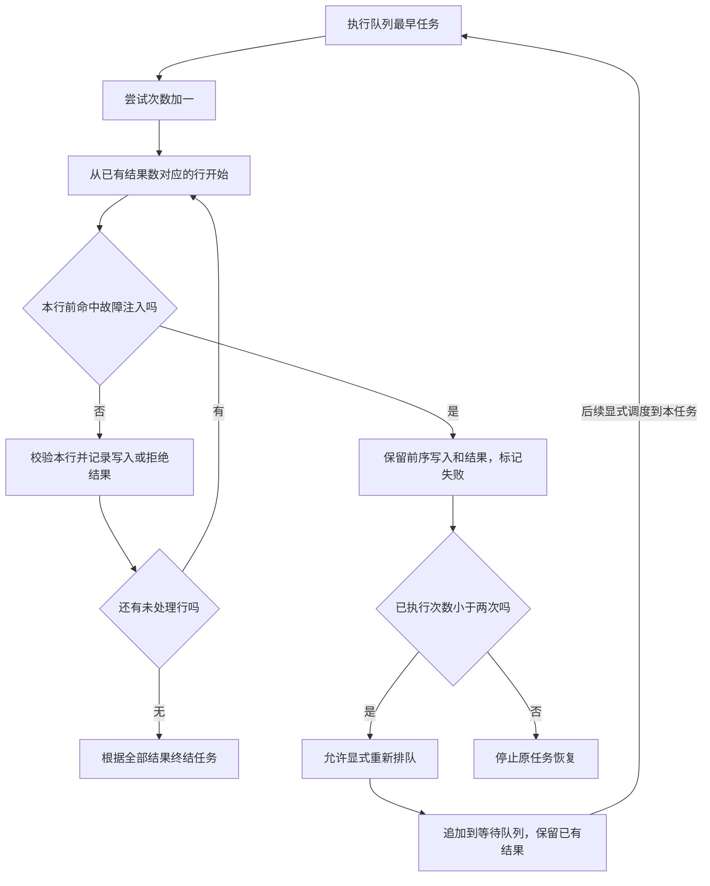

# 执行与恢复：保留已处理结果，继续剩余行

本模块把已受理的联系人输入行变成实际内存记录，并在指定故障发生时给出可解释的停止位置。它负责逐行校验、按邮箱创建或覆盖、记录行结果、确定终结状态和有条件恢复；任务创建和幂等请求识别由[提交与查询模块](submission-query.md)负责。

**这是内存模拟教学项目。** 调度者必须显式调用执行入口，执行调用本身同步处理整批剩余行。没有真实工作线程、消息消费进程、存储持久化或自动重试。以下人员与邮箱均为示例数据。

## 按当前停止位置选择动作

| 场景 | 前提 | 完成或停止信号 |
| --- | --- | --- |
| 执行一个等待批次 | 当前实例队列非空 | 全部行有结果，或发生模拟故障 |
| 恢复中断批次 | 存储故障、任务失败且可重试 | 重新执行后读取结果，不能停在排队成功 |
| 处理数据拒绝 | 部分或全部行校验失败 | 旧任务已终结；改数据后创建新任务 |
| 判断次数耗尽 | 第二次执行仍遇存储故障 | 原任务失败且不可重试，残留写入仍保留 |

## 场景一：执行队列中的一批联系人

调度者调用 `run_next`，系统取出先进先出队列中的一个任务号。空队列返回 `None`；有任务时先将状态改为 `running` 并增加一次执行次数，然后从已有结果列表的末尾继续。

每行先去掉姓名和邮箱首尾空白，再把邮箱转小写。空姓名优先被拒绝；姓名有效时才检查邮箱格式。无效行追加拒绝结果并继续下一行，有效行以“租户＋归一化邮箱”为业务键创建或覆盖联系人，再追加相应结果。

当所有行都得到结果，系统根据拒绝数终结：全部有效为 `succeeded`，有效与拒绝混合为 `partial`，全部拒绝为 `failed` 且错误为 `all_rows_rejected`。处理数包含拒绝行，写入数包含创建和更新行；后者不是去重后人数。

`running` 仅表示执行调用内部确实存在这个阶段。单线程顺序调用中，提交者无法在一次 `run_next` 的中间插入 `query`；执行返回后看到的是此次终结或故障状态。不能据此声称系统已经提供后台实时进度轮询。

## 恢复时最重要的分支



这张图突出恢复起点和次数边界。重新排队不是即时执行，任务仍需要下一次显式调度，也可能排在其他等待任务之后。图中的“停止原任务恢复”不等于删除联系人或回滚历史写入；已处理结果继续留在当前实例。

## 场景二：在第二行前失败后继续剩余行

本场景从新建的空导入器实例开始，联系人为空且没有更早排队任务。提交者希望导入陈青和许白两位联系人。两行均合法，使用示例租户 `team-a` 和新键 `batch-b` 受理。教学调度者希望检查“已经写完第一行，第二行前发生故障”时是否能够继续，因此指定绝对下标 1。

```python
job = importer.submit("team-a", "batch-b", [
    {"name": "陈青", "email": "chen@example.test"},
    {"name": "许白", "email": "xu@example.test"},
])
failed = importer.run_next(fail_before_row=1)
```

在本案例队列没有更早任务的前提下，第一行先创建陈青并追加 `created` 结果，第二行开始前命中故障。返回值为 `failed`，`error=storage_unavailable`、`processed=1`、`written=1`、`attempts=1`、`retryable=true`。许白尚未写入，陈青已经存在，不发生整批回滚。

调用方随后用相同租户和任务号请求恢复。恢复入口检查任务是失败状态且允许重试，清除当前错误、设回等待并追加队列，保留第一行结果和已写联系人。

```python
queued = importer.retry("team-a", job["job_id"])
finished = importer.run_next()
```

第一个返回值的 `processed` 仍为 1，`attempts` 仍为 1；它只表示等待继续。第二个调用才增加次数并从下标 1 执行许白。最终 `succeeded`、`processed=2`、`written=2`、`attempts=2`，两条结果均为 `created`。第一条没有变成 `updated`，说明当前恢复流程没有重做它。

这项保证来自输入副本、按顺序追加的行结果以及仅在行处理前注入故障。它不能证明真实存储中“联系人已写但进度未记”时也能安全恢复，更不承诺进程重启后找回这些内存记录。

## 场景三：判断不能恢复的失败

数据全拒绝同样会显示 `failed`，但 `processed=total`、错误为 `all_rows_rejected`，且可重试标记为假。所有行已经完成业务判定，再执行原输入没有修正意义。应由提交者修正数据，以新幂等键建立新任务；`partial` 也是同样的新请求路径。

另一种不可恢复情况是第二次执行再次命中存储故障。任务保留已有结果，错误仍为 `storage_unavailable`，但 `attempts=2`、`retryable=false`。调用恢复会被拒绝；系统没有第三次尝试、自动延期、补偿任务或人工强制重置接口。

这时调用方应先核对每条已有结果和未处理行，再决定新的业务请求。若用新键重新提交整批，会再次覆盖其中已成功的联系人；若只补剩余行，可减少重复写入，但这是调用方的选择，不是系统自动策略。无论如何，都不能将不可恢复解释为此前写入已经消失。

## 运行约束与排查

| 现象 | 原因边界 | 下一步 |
| --- | --- | --- |
| 指定故障下标却未失败 | 下标不在本次剩余行范围，或实际执行了队列中另一个任务 | 核对返回任务号、总数、已有结果数和绝对下标 |
| 恢复后任务仍在等待 | 恢复仅入队，没有自动调度 | 显式执行，并检查前面是否有其他任务 |
| 第二次恢复调用被拒绝 | 第一次恢复已将状态改为等待，或执行次数已耗尽 | 查询当前状态，避免重复追加同一任务 |
| 修正原列表没有改善结果 | 受理时已保存输入副本 | 用新键提交新的修正请求 |

目前没有独立日志、重试队列或监控页面，定位依靠任务快照、逐行结果和教学调用顺序。[基础设施专题](../infrastructure.md)给出实际资源和配置，[规则专题](../rule.md)拥有重试资格与统计主定义，[状态专题](../state_machine.md)解释全部转换。

## 修改与验证入口

扩展行规则和写入行为时，主要关注 `ContactImporter.run_next`；修改恢复资格与排队动作时，关注 `ContactImporter.retry`。任何新增异常处理都要明确发生在行写入前还是之后，并说明联系人和行结果能否同时保存，不能笼统扩大为“失败可重试”。

验证应同时检查过程和结果：故障前已写记录保留，故障行没有结果，重新排队不加执行次数，下一次从未处理行开始，已有结果不被重做，耗尽次数后确实拒绝恢复。还要分别运行全行拒绝与部分成功，防止将数据修正路径误接到故障恢复路径。
