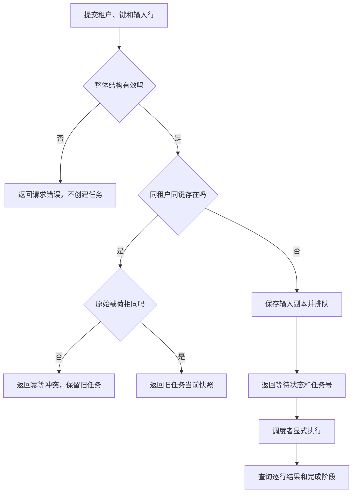

# 提交与查询：把一批联系人变成可追踪的任务

本模块服务于提交联系人批次的人：在重复调用时识别同一次请求，让提交者拿到稳定的任务号，并依据逐行结果判断哪些联系人已经写入、哪些行需要修正。它拥有任务受理与查询语义；实际执行和故障恢复由[执行与恢复模块](execution-recovery.md)负责。

这是教学项目，以下姓名、邮箱和租户均为示例。调用方持有同一个导入器实例，所有任务和联系人保存在内存。这里没有 HTTP 页面、文件上传、真实鉴权或自动后台工作；提交成功之后，调度者必须显式驱动执行。

## 先选当前要完成的任务

| 场景 | 完成信号 | 常见误判 |
| --- | --- | --- |
| 提交新批次 | 获得 `job_id` 和等待状态快照 | 将受理成功当成联系人已写入 |
| 确认重复请求 | 同键同载荷返回原任务当前快照 | 以为相同键会强制重跑 |
| 解释部分成功 | 全部行有结果，读懂写入数和拒绝原因 | 将写入行数当成新增联系人数 |
| 修正无效行 | 新任务处理修正后的行并返回终结结果 | 用原键改输入，或恢复已终结的部分成功任务 |

## 场景一：提交三行，确认已经受理

本场景使用新建的空导入器实例，联系人为空且没有更早排队任务。运营者希望导入林禾、周宁两位联系人，并用第三行更新林禾的姓名。提交者传入租户 `team-a`、幂等键 `batch-a` 和三行列表。前提是每行恰好包含字符串 `name` 与 `email`，行数在 1–100 之间；租户必须非空白，幂等键长度为 1–64。

```python
# 示例输入：同一归一化邮箱出现两次，中间有一行坏邮箱。
rows = [
    {"name": "林禾", "email": "LIN@example.test"},
    {"name": "周宁", "email": "bad-address"},
    {"name": "林禾（更新）", "email": "lin@example.test"},
]
accepted = importer.submit("team-a", "batch-a", rows)
```

系统先做整体结构检查，再查同租户幂等键。新请求会保存输入副本和任务，追加任务号到队列，并返回 `queued`。此时 `total=3`、`processed=0`、`written=0`、`attempts=0`。示例中的坏邮箱并不阻止受理，因为行值校验将在执行时发生。

提交者应保存返回的任务号，再通过查询观察结果。调用之后即使修改原来的 `rows`，也不会修改已受理任务；任务已保存输入副本。只有新的任务才能携带修正后的输入。

## 从受理到查询的关键分支



这张图帮助提交者决定该等待、纠正请求还是读取旧任务。旧任务快照可能仍在等待，也可能已经完成；同键同载荷不会再次进入执行路径。图中的显式执行由另一个模块承担，它不是查询自动触发的动作。

## 场景二：重复提交，确认原请求结果

提交者不确定上一次调用是否已被业务层受理时，可以用完全相同的租户、键和原始行列表再次调用。任务存在且指纹相同，就返回原任务当前快照；队列不会增加第二份工作。首次执行前返回 `queued`，执行结束后则返回最终结果。

这个幂等约束关注原始请求，不关注最终联系人是否相同。将 `LIN@example.test` 改成小写，或者给姓名增加空格，即使执行时归一化后相同，原键重提仍会冲突。只调整每行对象键的排列不冲突，因为指纹计算会统一键顺序。

发生 `IdempotencyConflict` 后，先核对是否错误复用了键。若确实是新请求，使用新键；若只是想知道旧请求结果，查询旧任务。系统没有以同键修改已受理输入的入口。完整比较规则见[规则 R2](../rule.md#r2幂等键保护同一次请求不修改旧请求)。

## 场景三：读懂部分成功，并完成坏行修正

教学调度者调用一次执行后，三行依次得到：第一行 `created`，第二行 `rejected` 且原因为 `invalid_email`，第三行 `updated`。查询结果是 `partial`，`processed=3`、`written=2`、`rejected=1`。联系人现值只有一条，姓名为“林禾（更新）”。

这里的“2”表示两行有效写入，不表示新增两个人。`processed` 包含被拒绝行，所以处理进度已经达到 3/3。`partial` 是本批终结结果，系统不会继续尝试修复周宁的邮箱；原任务恢复也不允许用于这一状态。

提交者从行结果定位原始第 2 行，修正邮箱为示例值 `zhou@example.test`，使用新键 `batch-a-fix` 提交单行请求。调度者执行新任务后，该行被创建，新任务为 `succeeded`。旧任务仍为 `partial`，保留原批次的真实记录，不会因为新任务成功而改写历史结果。

```python
fixed = importer.submit("team-a", "batch-a-fix", [
    {"name": "周宁", "email": "zhou@example.test"},
])
# 显式执行后，再用 fixed["job_id"] 查询新任务完成情况。
```

这条修正路径只补需要修正的行，减少对已写联系人的再次覆盖；它是调用方可以选择的操作方式，系统没有自动挑选坏行或自动创建补偿任务。

## 查询失败和等待不动时怎样定位

查询需要正确任务号，且传入租户必须与原租户完全相等。`team-a` 和 ` team-a ` 不会自动合并，错误租户与不存在任务都得到 `JobNotFound`。租户字段只用于分区，不能当成真实权限凭证。

如果一直得到 `queued`，先确认是否有人调用执行，以及队列前面是否还有其他批次。不要通过重复提交试图推动执行，也不要把长时间等待解释为系统自动重试。执行中的 `running` 是单线程调用内部阶段，普通顺序查询不会在执行调用中途插入观察。

若查询得到 `failed`，根据 `error` 区分全行拒绝与模拟存储故障。前者修正数据后建新任务；后者查看 `retryable` 并进入[恢复场景](execution-recovery.md#场景二在第二行前失败后继续剩余行)。失败任务可能已经写入前序联系人，不能把错误响应解释成整批回滚。

## 修改与验证入口

调整受理范围和幂等语义时，关注 `ContactImporter.submit` 的检查顺序、指纹和任务入队责任；调整查询可见字段时，关注 `ContactImporter.query` 与快照转换职责。源码坐标保留在元数据中，详细字段与异常契约分别由[对象](../object.md)和[接口](../api.md)专题拥有。

至少复核以下业务结果：同键同载荷不新增工作；同键不同载荷保护旧输入；字段结构错误不创建任务；无效行能被受理并在执行时拒绝；重复邮箱的写入数与独立人数不同；错误租户不能读到任务。若改变归一化或幂等比较时机，还需同步修订本模块的正反案例。
