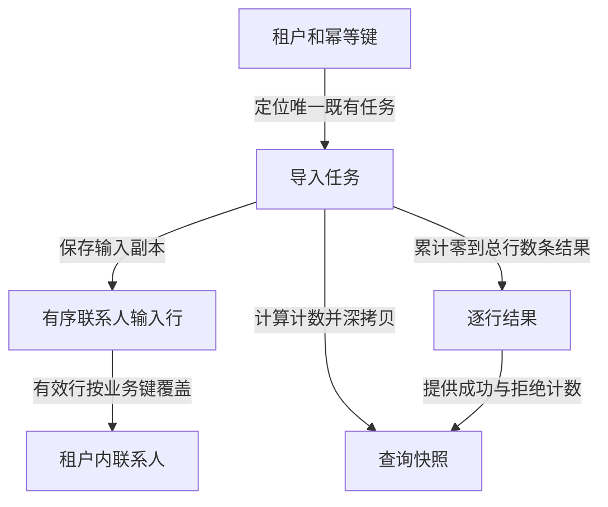

# 对象：导入经历与联系人现值

教学实现把“这次导入发生了什么”保存在任务中，把“当前联系人叫什么”保存在联系人字典中。任务结果是逐行处理记录，联系人是按业务键覆盖后的当前值。二者都只存在于同一个导入器实例的内存，进程重启或新建实例后不会保留。

## 对象关系与责任

图中一条有效输入行对应一次联系人写入，但不一定对应一个新联系人。多个任务和多条行都可以更新同一租户的同一邮箱；任务不会通过外键拥有或删除联系人。这里没有联系人删除、任务删除或幂等键清理操作。

| 对象 | 谁创建、谁修改 | 主要用途 |
| --- | --- | --- |
| 输入行 | 提交者提供；受理时复制，此后不修改 | 保留顺序与原始载荷，供幂等比较和后续执行 |
| 导入任务 | 受理创建；执行器和恢复入口修改 | 保存当前状态、尝试次数和逐行处理进度 |
| 逐行结果 | 执行器按输入顺序追加 | 解释成功写入或拒绝原因，也是继续执行的位置依据 |
| 联系人 | 执行器创建或覆盖 | 保存租户内归一化邮箱对应的最新姓名 |
| 查询快照 | 每次公开入口需要返回任务时重新生成 | 对外表达任务现状，不提供修改任务的引用 |

## 联系人输入行

每行必须恰好包含 `name` 和 `email` 两个字符串字段，没有可选字段和默认值。字段缺失、多余、类型错误使整批在受理阶段失败；字段是空字符串时可受理，随后由行规则判断。

| 字段 | 类型与取值 | 业务含义和处理 |
| --- | --- | --- |
| `name` | 字符串，必传；没有长度上限 | 原始姓名；执行时去首尾空白，结果为空则拒绝该行 |
| `email` | 字符串，必传；没有长度上限 | 原始邮箱；执行时去首尾空白并转小写，再做教学格式检查 |

列表顺序具有业务意义。同邮箱两条有效行按顺序覆盖，最后一条成为当前姓名；其中一条被拒绝时不会覆盖已有联系人。示例中的 `LIN@example.test` 和 `lin@example.test` 执行后指向同一个联系人，但提交时仍属于不同原始字符串。

## 导入任务

任务是本次导入的权威过程记录。`job_id` 在实例内按任务数依次生成，例如 `import-1`；它不是全局唯一标识，不承诺跨实例或跨重启稳定。外部调用需同时提供所属租户，避免仅凭任务号读取其他分区。

| 身份和输入字段 | 类型、默认与约束 |
| --- | --- |
| `job_id` | 字符串；受理时生成，不修改 |
| `tenant_id` | 非空白字符串；原样保存，作为任务和联系人分区，不代表已认证身份 |
| `idempotency_key` | 长度 1–64 的字符串；与租户组成复合键，任务存续期间绑定原始载荷 |
| `fingerprint` | SHA-256 十六进制字符串；从规范化 JSON 序列化后的原始行列表生成 |
| `rows` | 非空有序列表，最多 100 行；受理时深拷贝，恢复沿用，不接受就地改行 |

指纹计算会统一对象键顺序，却不改变字符串和列表顺序。它用于判断同键请求是否相同，不是业务联系人唯一键，也不能代替来源真实性校验。

| 过程字段 | 类型、默认与写入语义 |
| --- | --- |
| `status` | 字符串，初始 `queued`；完整枚举和转换由[状态专题](state_machine.md)定义 |
| `attempts` | 整数，初始 0；每次真正出队执行加 1，重新排队不增加 |
| `results` | 有序结果列表，初始空；完成一行便追加一条，已有项在恢复中保留 |
| `error` | `null` 或错误标识；初始空，整批全拒绝或模拟故障时设置，重新排队时清空 |
| `retryable` | 布尔值，初始 `false`；只在未耗尽次数的模拟存储故障后为 `true` |

结果列表长度就是恢复游标。它依赖单进程顺序执行、每行结果依次追加以及故障只在处理行之前注入。实现没有持久事务、版本号或并发锁，不能将这个游标推广为真实进程崩溃后的 exactly-once 保证。

## 逐行结果

结果一旦追加，就不会被当前恢复流程重做或改写。后续任务可能改掉联系人姓名，旧任务的结果依然说明旧批次当时发生过一次创建或更新；结果没有完整的姓名历史。

| 字段 | 类型和含义 |
| --- | --- |
| `row_index` | 从 0 开始的整数，对应原始列表位置；展示给人时可称第 `row_index+1` 行 |
| `email` | 去首尾空白并转小写后的字符串；被拒绝时也保留，可能仍不合法或为空 |
| `outcome` | `created`、`updated` 或 `rejected`；前两者表示实际完成了一次联系人写入 |
| `reason` | 成功时为 `null`；拒绝时为 `empty_name` 或 `invalid_email` |

若姓名和邮箱同时不合法，先记录 `empty_name`。修正姓名后再次提交，可能才暴露邮箱问题；这不是校验结果矛盾，而是检查顺序。逐行结果只记录首个命中的业务拒绝原因，不是所有字段问题的全集。

## 联系人现值

| 字段 | 类型、来源与约束 |
| --- | --- |
| `tenant_id` | 字符串，来自任务；参与内存复合键，原样保存 |
| `email` | 归一化字符串；与租户组成唯一业务键，没有额外的数值主键 |
| `name` | 去首尾空白后的非空字符串；同业务键的最后一条有效写入覆盖旧值 |

姓名与邮箱可能属于个人信息；本例仅使用虚构数据。实现没有掩码、加密、审计或保留期限机制，不应据此推断真实项目的敏感数据保护能力。公开接口也没有独立联系人查询方法，教学自验通过实例内记录核对最终写入。

## 对外任务快照

快照只返回任务结果，不暴露原始输入、租户、幂等键和指纹。没有分页；最多返回本批全部行结果。计数是根据输入和结果实时计算的派生值，不是独立维护的统计实体。

| 字段 | 类型和读法 |
| --- | --- |
| `job_id`、`status` | 字符串，复制任务身份和当前阶段 |
| `total` | 整数，原始输入行数，受理后不变 |
| `processed` | 整数，已有结果数量；包含有效行和拒绝行 |
| `written` | 整数，结果中 `created` 与 `updated` 的总数；表示写入行次，不是独立联系人数 |
| `rejected` | 整数，结果中 `rejected` 的数量 |
| `attempts`、`retryable` | 整数与布尔值，说明执行次数和当前恢复资格 |
| `error` | `null`、`all_rows_rejected` 或 `storage_unavailable` |
| `results` | 深拷贝后的逐行结果列表；与本快照计数属于同一时点 |

始终有 `processed = written + rejected`，且 `processed <= total`。在初始联系人为空的三行示例中，第 1 行创建林禾、第 2 行邮箱错误、第 3 行更新林禾，得到 `processed=3`、`written=2`、`rejected=1`，但联系人只有一个。若在第 3 行前发生故障，则只存在前两条结果和此前已写联系人；[执行与恢复手册](modules/execution-recovery.md)解释如何继续。
