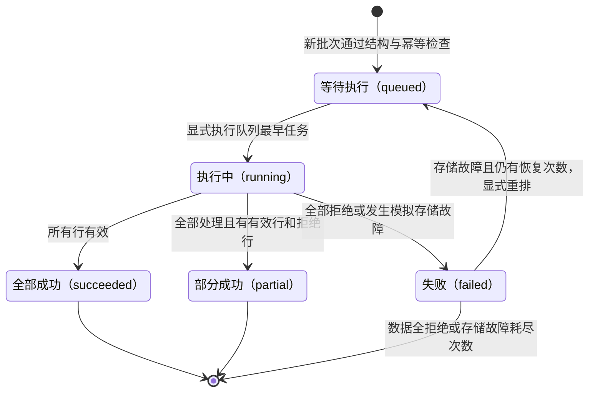

# 状态：受理之后怎样判断真正完成

一个任务可能已经成功受理，却没有开始写联系人；也可能显示失败，却保留此前的成功写入。读状态时需要同时看处理数量、错误标识和可重试标记。本页描述教学项目实际存在的五个状态，没有取消、超时、自动退避或外部完成通知。

## 状态转换

图中 `failed` 有两种不同性质。全行拒绝表示业务检查已经结束；存储故障表示执行被打断。只有后一种且 `retryable=true` 才能回到等待状态。查询、同键同载荷重复提交、非法恢复请求都不会产生状态转换，因此没有画成新的箭头。

## 每个状态对读者意味着什么

| 状态 | 已经发生的事 | 下一步判断 |
| --- | --- | --- |
| 等待执行 `queued` | 新任务已保存并排队，或失败任务已重新排队 | 需要显式执行；恢复后的等待任务可保留已有结果 |
| 执行中 `running` | 任务已出队，执行次数已加一，正在逐行处理 | 教学调用在同一线程内继续，没有对外并发观察保证 |
| 全部成功 `succeeded` | 全部行都有成功写入结果 | 本批处理结束，`written=total` |
| 部分成功 `partial` | 全部行都有结果，至少一行写入且至少一行拒绝 | 本批处理结束；从拒绝结果整理修正请求 |
| 失败 `failed` | 全部行被拒绝，或某行前遇到模拟故障 | 看 `error`、`processed`、`retryable`，不能仅凭状态决定重试 |

新建 `queued` 的 `processed=0`，但恢复后的 `queued` 可能是 1、2 或其他小于总数的值。若只按状态名称把它描述为“尚未处理任何行”，会掩盖故障前的联系人写入。

## 转换条件与动作

受理时先完成整体结构检查，再处理幂等键；只有新的合法请求会创建任务并进入等待队列。开始执行时先出队、设为 `running`、增加 `attempts`，然后处理剩余行。没有独立的“消息已持久化”“已投递远端”状态，因为这里不存在这些阶段。

每完成一行，就追加一条成功或拒绝结果。有效行先写联系人现值，再追加结果；无效行只追加拒绝结果。正常遍历全部结束后根据拒绝数量终结。模拟故障在某行的处理之前触发，这行尚无结果，前序写入和结果保持不变。

| 事件 | 进入条件 | 转换动作与退出信号 |
| --- | --- | --- |
| 新批次受理 | 结构有效且租户、键尚未绑定任务 | 保存输入与索引、入队；返回 `queued / attempts=0` |
| 队首任务开始 | 队列非空，故障参数合法 | 出队、设 `running`、次数加一、恢复标记置假 |
| 逐行处理结束 | 每行都有结果 | 按拒绝数选 `succeeded/partial/failed`；处理数等于总数 |
| 行前模拟故障 | 绝对下标命中本次未处理行 | 设 `failed` 和存储错误；保留前序结果，按次数决定恢复标记 |
| 显式重新排队 | 同租户任务为 `failed` 且可恢复 | 设 `queued`、清空错误、关闭恢复标记、追加队尾；次数与结果不变 |
| 查询或同键同载荷提交 | 任务可见，提交时结构仍合法 | 只返回快照；无转换、不额外入队 |

结构拒绝不生成“失败任务”；非法恢复不改变已有状态。空队列执行返回 `None`，也不是一次状态转换。图中的终点表示当前公开流程不再执行该任务，任务记录仍留在内存，并非删除。

| `failed` 的依据 | 完成口径 | 恢复与残留 |
| --- | --- | --- |
| `all_rows_rejected` | `processed=total`，所有行已检查 | 没有本批有效写入；修正数据后用新键建任务 |
| `storage_unavailable`，`attempts=1` | `processed<total`，执行中断 | 保留已写数据；`retryable=true`，可重新排队 |
| `storage_unavailable`，`attempts=2` | `processed<total`，执行中断 | 保留已写数据；`retryable=false`，没有原任务继续入口 |

“失败”不是回滚承诺，“不能重试”也不是“未发生任何写入”。次数耗尽后，若业务需要新任务补齐，调用方必须先核对已有结果，决定仅提交剩余行还是按业务规则重复覆盖；系统没有自动生成补偿任务或回滚动作。

## 贯穿案例：三行里有一个坏邮箱

以下均为示例数据，使用新建的空导入器实例，队列没有更早任务。联系人甲和“联系人甲（更新）”两行归一化后拥有同一个邮箱，联系人乙一行的邮箱不合法。受理后任务是 `queued`，总行数 3、处理数 0。显式执行后按顺序产生 `created`、`rejected`、`updated`，状态成为 `partial`，处理数 3、写入数 2、拒绝数 1。

这个 `partial` 已经终结。调用方可以提示“3 行已处理，2 行写入，1 行需修正”，不能提示“已新增 2 个联系人”，也不应调用原任务恢复。修正联系人乙的邮箱后，用新幂等键提交一行，构成第二个独立任务。

## 贯穿案例：保留第一行后继续第二行

另一个示例批次有联系人丙和联系人丁两行。在第二行之前注入存储故障，任务从 `running` 进入 `failed`，已有联系人丙的创建结果，`processed=1`、`attempts=1`、`retryable=true`。

调用 `retry` 后回到 `queued`，已有结果仍为 1 条，尝试次数仍为 1。再次显式执行，跳过已有结果对应的第一行，只创建联系人丁，最后为 `succeeded`、`processed=2`、`attempts=2`。完成信号来自这次执行返回值或随后查询，不能来自重新排队的返回值。

| 可查询时点 | 状态 | 处理数 / 总数 | 次数 | 错误 / 可恢复 |
| --- | --- | --- | --- | --- |
| 首次受理后 | `queued` | 0 / 2 | 0 | `null / false` |
| 第一次执行中断后 | `failed` | 1 / 2 | 1 | `storage_unavailable / true` |
| 显式重排后 | `queued` | 1 / 2 | 1 | `null / false` |
| 再次执行成功后 | `succeeded` | 2 / 2 | 2 | `null / false` |

若第二次仍在下标 1 之前注入故障，最后一行改为 `failed`、处理数 1、次数 2、存储错误且不可恢复。第一条联系人仍保留，原任务没有第三次执行入口。若剩余第二行本来是坏数据，则恢复执行可以正常结束为 `partial`；“故障已恢复”和“全部行有效”是两种判断。

完整调用过程见[执行与恢复手册](modules/execution-recovery.md)；字段与统计的唯一主定义见[对象专题](object.md)。
