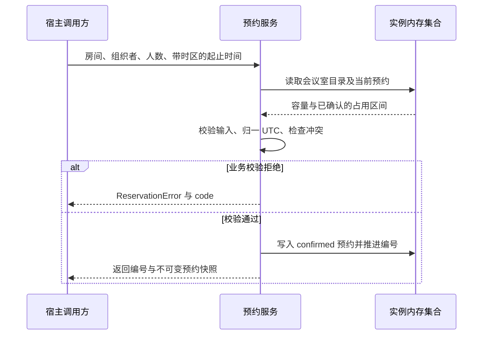

---
anchors:
  locations:
    - path: reservation_source.py
      symbol: ReservationService.__init__
      startLine: 40
      endLine: 46
    - path: reservation_source.py
      symbol: ReservationService.create_reservation
      startLine: 48
      endLine: 92
    - path: reservation_source.py
      symbol: ReservationService.cancel_reservation
      startLine: 94
      endLine: 105
---

# 协作链路

本教学项目的协作边界是“宿主代码调用预约服务，服务读取目录和当前预约集合，再同步返回结果”。没有远程下游、消息消费者、邮件通知或独立存储服务。下图中的内存集合属于预约服务实例，单独画出是为了说明读写时点，不表示一次网络调用。

| 协作方 | 责任与交接结果 | 详情 |
| --- | --- | --- |
| 宿主调用方 | 准备输入、复用实例、处理返回与异常 | [宿主责任](#宿主调用方) |
| 预约服务 | 完成校验，拥有当前预约状态及编号 | [同步处理](#同步创建的读写顺序) |
| 实例内存资源 | 固定会议室目录、当前记录与编号计数 | [运行资源](infrastructure.md) |

## 同步创建的读写顺序

图将目录及预约读取合并为一个资源交互，以突出“先判断、后写入、再返回”。实际校验按[规则顺序](rule.md#校验顺序与失败副作用)短路，早期输入不合格时不必遍历预约集合。图不引入事务、远程确认或后台阶段。

成功返回前，当前实例已经保存本次预约。宿主可以据此显示预约建立，但不能显示“已发通知”或“数据已永久保存”，因为这些操作不存在。业务拒绝直接返回给宿主，没有创建失败记录，也没有自动补偿。

## 取消怎样把责任交回宿主

宿主传入同一实例内的预约编号和取消原因。服务找到记录、验证原因后，首次取消替换状态并返回新快照；有效重复取消返回已经保存的取消结果。状态转换的主图与条件见[状态机](state_machine.md)，模块中的操作分支见[取消手册](modules/cancel-reservation.md)。

| 交接点 | 已成立的事实 | 宿主接下来做什么 |
| --- | --- | --- |
| 创建正常返回 | 当前实例内已建立占用 | 保存编号和结果，更新显示 |
| 取消正常返回 | 记录为 cancelled，不再占用 | 用本次返回值替换旧显示 |
| 业务错误抛出 | 对应校验未通过，未执行该次业务写入 | 按错误码修正输入或实例上下文 |
| 非预期运行异常 | 没有专门的结果确认协议 | 保留异常，不能假定可安全盲重试 |

## 宿主调用方

宿主是服务生命周期与使用方式的所有者：它构造实例、在相关操作间复用该实例，并负责把有业务意义的输入转换为 Python 参数。服务会规范化文本和时区，但不会识别登录用户、确认参会者名单或授权取消。

**示例数据：** 林青创建成功后，宿主持有 `RES-0001` 和 `confirmed` 快照。会议改期后，宿主把同一编号与“会议改期”传给原实例，并用返回的 `cancelled` 快照刷新显示。若仍展示创建时的旧对象，界面会显得没有取消，但服务内的占用已释放。

宿主若为每次请求重新构造服务，创建与取消就不会共享预约集合。更危险的是，新实例可能重新发出同号记录，旧编号会失去原有意义。如何保持实例和数据的生命周期见[基础设施](infrastructure.md#实例内的权威预约集合)。

## 超时、重试与扩展

本实现没有网络调用，因此没有连接超时、RPC 重试、队列积压或降级开关。没有远程依赖不等于没有失败：错误输入会被拒绝，进程终止会丢失状态，并发访问也没有一致性保证。

宿主不能用重复创建来查询第一次是否成功；它可能得到占用错误。有效重复取消仅在同实例内保留结果，不能代替跨进程的去重协议。若将来接入数据库、通知或消息，应重新定义每个交接点的已提交事实、失败责任和最终完成信号，不能直接沿用“方法返回即全部完成”的描述。
