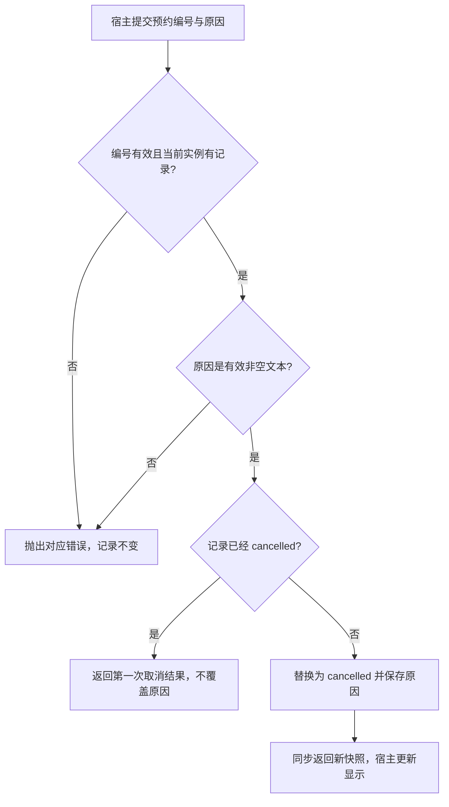

# 取消会议室预约

本模块让宿主取消同一服务实例中已经存在的预约，释放该记录占用的会议室时段，同时保留取消原因与原预约信息。调用入口为 `cancel_reservation`，输入是预约编号和原因，正常返回 `cancelled` 快照。

这是一份单实例、内存存储的教学手册。取消是同步方法，没有待审批或异步清理阶段；它不删除记录，也不检查当前操作者身份。能取得服务对象并知道编号的调用方即可发起取消，实际系统若有权限要求必须另行设计。

## 场景与结果

| 场景 | 想达成的结果 | 详情 |
| --- | --- | --- |
| 会议改期，释放原时段 | 首次原因被保存，原占用立即失效 | [首次取消](#会议改期后释放原时段) |
| 宿主重复提交取消 | 保留第一次结果，避免覆盖原因 | [重复请求](#重复取消与无效原因) |
| 取消后仍需开会 | 为新安排建立独立预约 | [重新安排](#取消后重新安排会议) |

## 核心场景

### 会议改期后释放原时段

**示例数据：** 林青此前已在当前服务实例创建 A201 的 `2026-11-05 09:00—10:00 +08:00` 预约，编号为 `RES-0001`，人数为 4。现在会议改期，宿主把编号与原因“会议改期”交给同一个实例。

1. 宿主从创建成功的返回值取得编号，不通过日期或组织者推测编号。服务去除编号首尾空白并检查编号文本类型与长度，再读取该记录。
2. 记录存在后，服务校验原因：必须是去空白后非空且最多 200 字符的字符串。找不到记录时先报不存在，不会因传入原因而创建一条取消记录。
3. 记录当前为 `confirmed`，服务构造一个保留原身份、房间、人员与时间的新对象，把状态改为 `cancelled`，原因为“会议改期”，并替换集合中的当前记录。
4. 服务同步返回新快照。此时原记录已不参与后续冲突判定，宿主可显示“已取消”；没有待通知或待释放的后台阶段。
5. 宿主用本次返回值更新显示。创建时保存的旧对象仍为 `confirmed`，因为对象不可变；旧显示不能否定这次取消结果。

图特意把原因校验放在重复状态判断之前。重复取消不是绕过输入规则的快捷路径；这一顺序决定了无效原因仍会报错。完整状态迁移由[状态机](../state_machine.md)定义，图中的“记录不变”指可预期业务错误分支。

### 重复取消与无效原因

第一次取消后，宿主又以“再次取消”为原因调用同一编号。因为原因有效且记录已经 `cancelled`，服务直接返回第一次取消对象，`cancel_reason` 仍为“会议改期”。它不增加记录，也不改写取消原因。

若重复请求的原因只有空白，服务会得到 `invalid_reason`，原记录依然保持已取消。调用方应区分“本次请求被拒绝”和“预约仍未取消”：已有状态不会因为第二次输入错误回退。准确的判定表见[取消规则](../rule.md#取消的顺序与重复请求)。

### 取消后重新安排会议

取消只让旧记录不再占用时段，没有修改时间、重新激活或恢复接口。林青若仍要在原时段开会，需要调用[创建预约](create-reservation.md)建立新记录；若其他记录不冲突且输入合法，创建可以成功，并取得新编号。

取消和新创建之间没有跨操作事务。如果新创建被容量或冲突规则拒绝，旧记录仍然是 `cancelled`，不会自动恢复为占用。宿主应分别展示两次操作的真实结果，不能把“取消成功”描述为“改期成功”。

## 输入、异常与完成判断

本模块只接收编号和原因，其他字段来自已有预约。两项参数的完整类型、长度与错误定义见[取消接口](../api.md#取消预约)。没有操作者字段、取消期限或当前时钟判断，所以即使预约时间已经过去，合法取消仍会成功。

| 现象 | 当前结果 | 定位与处理 |
| --- | --- | --- |
| `invalid_reservation_id` | 未读取或改变预约 | 使用创建返回的完整编号 |
| `reservation_not_found` | 当前实例未找到该记录 | 核对实例和编号来源；不能视为已取消 |
| `invalid_reason` | 原有状态不变 | 补充有效原因后重试 |
| 正常返回 cancelled | 当前记录已取消或此前就已取消 | 使用返回快照更新显示 |
| 旧变量仍显示 confirmed | 可能仅持有创建时的快照 | 对照取消返回值，不等待原对象刷新 |

重复取消的有限幂等保证以同一实例为范围。新实例的编号会重新开始；旧编号在新实例里可能不存在，也可能对应另一条预约。当前没有恢复或跨实例确认协议，不能把它作为自动重试到任意新实例的依据。

## 修改与验证

`ReservationService.cancel_reservation` 拥有查找、输入校验和状态替换，创建模块的冲突筛选决定已取消记录是否真正释放时段。修改取消实现后，必须同时验证这两个责任，不能只断言返回字符串是 `cancelled`。

本地教学自验 `run_demo` 会检查首次取消、重复原因保留、旧对象不变和取消后重订。修改相关规则时，还应检查不存在编号、空白原因、已取消记录搭配无效原因，以及新建服务的编号范围。对象字段与返回快照的主定义见[核心对象](../object.md)，运行生命周期见[基础设施](../infrastructure.md)。
