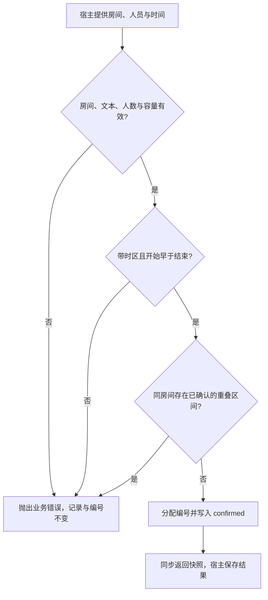

# 创建会议室预约

本模块帮助宿主为一场会议占用一个房间的连续时段。调用方提供房间、组织者、总人数和带时区的起止时间；服务依次检查输入、容量与冲突，通过后写入当前实例的内存，并同步返回已确认的预约。

这是一份教学手册。系统只有固定会议室目录和内存记录，没有用户登录、数据库、通知或后台审批。正常返回意味着当前实例内占用已经建立；实例丢失后预约不会保留。调用方必须顺序调用并复用服务实例，不能把本模块的冲突判断当成并发保护。

## 场景与结果

| 场景 | 目标与完成信号 | 详情 |
| --- | --- | --- |
| 为小组会议锁定时段 | 返回新编号及 confirmed 快照 | [首次预约](#为四人会议预约梧桐会议室) |
| 所需时段已被占用 | 明确拒绝，调整后重新提交 | [处理冲突](#时段冲突后调整安排) |

## 核心场景

### 为四人会议预约梧桐会议室

**示例数据：** 林青准备在 `2026-11-05 09:00—10:00 +08:00` 召开 4 人会议。按教学业务约定，这个数字包含组织者；实现仅校验人数值，不核实人员名单。宿主持有一个尚无预约的服务实例，选择容量为 6 人的 A201“梧桐会议室”，调用 `create_reservation`。

| 输入 | 示例值 | 怎样参与判断 |
| --- | --- | --- |
| 会议室 | `A201` | 查目录、取得容量，并限定冲突比较范围 |
| 组织者与总人数 | `林青`，`4` | 校验标签和人数，4 不超过容量 6 |
| 起止时间 | `09:00—10:00 +08:00` | 归一为 UTC，比较先后与已有占用 |

1. 宿主提供全部参数，不依赖默认房间或默认时区。服务去除文本首尾空白，再确认房间存在、组织者有效、人数合法且容量足够。
2. 服务把起止时间转换为 UTC。示例对应 `01:00—02:00 UTC`，实际会议时刻不变；开始必须早于结束。
3. 服务检查同房间的已确认预约。当前实例为空，所以没有重叠占用；若有已取消记录，它们不参与冲突判断。
4. 服务生成 `RES-0001`，把状态为 `confirmed`、取消原因为 `None` 的记录写入内存，推进编号后返回预约对象。
5. 宿主保留返回编号和快照并展示结果。到此本模块已经完成，没有需要轮询的“处理中”阶段，也没有隐含通知任务。

图把相关输入判断合并成三个决策点，帮助读者找到拒绝发生在写入之前的位置。各字段的精确错误优先级以[规则顺序](../rule.md#校验顺序与失败副作用)为准；图没有表达锁或事务，也没有承诺所有运行故障都可回滚。

### 时段冲突后调整安排

在上述预约仍为 `confirmed` 时，另一场 A201 的 09:30—10:30 请求与它重叠，会得到 `room_unavailable`。服务不生成失败记录，也不推进编号；调用方可以调整为 10:00—11:00，或换用另一间容量允许的会议室。

10:00—11:00 与原预约仅在边界相接，因此允许；这是半开区间规则，不是额外的“忽略冲突”开关。不同会议室同一时段也不互相阻挡。完整正反例见[区间冲突](../rule.md#同一会议室的区间冲突)。

如果原会议改期，宿主应先完成[取消预约](cancel-reservation.md)，再为所需时段创建新预约。取消与重新创建是两个同步操作，没有跨操作事务；不能保证在两次调用之间房间始终归原调用方保留。新预约会有新编号，原记录仍是已取消。

## 结果、失败与定位

创建返回的对象包含编号、房间、组织者、人数、UTC 时间、状态和取消原因，完整定义见[预约对象](../object.md#预约记录)。实例内集合是当前事实源；返回对象是不可变快照，后续取消不会自动改写创建时的变量。

| 现象 | 应先判断什么 | 可以采取的动作 |
| --- | --- | --- |
| `capacity_exceeded` | 人数是否包含所有参会者，房间容量是否足够 | 调整人数或房间 |
| `invalid_start_at` / `invalid_end_at` | 是否提交了带时区的 datetime，而非字符串或无时区值 | 明确时间表示再调用 |
| `room_unavailable` | 是否存在同房间、已确认、实际重叠的占用 | 调整时段或有效取消原占用 |
| 原样重试不能取得旧编号 | 创建没有请求幂等键，第一次可能已成功 | 保留第一次结果，不能用重试代替查询 |
| 重建服务后预约消失 | 本例只在实例内存保存记录 | 没有自动恢复；检查宿主生命周期 |

其余输入拒绝由[接口错误表](../api.md#拒绝与重试)完整定义。可预期业务错误发生在写入前；对于进程终止、结果丢失或其他运行异常，当前实现没有确认和补偿协议，不应盲目断言“必然未创建”。

## 修改与验证

`ReservationService.create_reservation` 拥有创建判定和内存写入，`_utc` 统一时间轴，固定会议室目录提供容量。修改一个条件时，应先说明它改变哪些请求的结果，再同步[接口](../api.md)、[规则](../rule.md)和当前案例；不要只改错误文本。

本地教学自验 `run_demo` 覆盖成功、UTC 归一、重叠拒绝、相邻时段、不同房间、取消后重订和部分输入拒绝。进一步修改时，至少保留开始等于结束、区间包含关系、人数恰好等于容量、布尔人数及失败不推进编号这些边界。扩展到多线程或持久化后，需要新增相应验证；现有顺序样例不能证明那些新保证。
