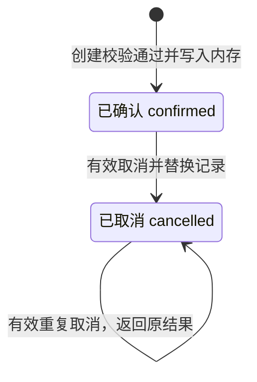

---
anchors:
  locations:
    - path: reservation_source.py
      symbol: Reservation
      startLine: 26
      endLine: 34
    - path: reservation_source.py
      symbol: ReservationService.create_reservation
      startLine: 48
      endLine: 92
    - path: reservation_source.py
      symbol: ReservationService.cancel_reservation
      startLine: 94
      endLine: 105
---

# 状态与完成

预约只有 `confirmed` 和 `cancelled` 两个业务状态，权威记录位于当前服务实例的内存中。它们不是数据库持久状态，也没有对应的消息状态或后台任务状态。创建和取消都在方法返回前同步完成其内存写入。

| 状态 | 含义 | 对新预约的影响 |
| --- | --- | --- |
| `confirmed` | 预约已经建立，仍占用所选房间区间 | 同房间重叠请求被拒绝 |
| `cancelled` | 预约已被有效取消，记录仍保留 | 不再参与冲突检查 |

## 合法变化

起始符号表示“尚未创建记录”，不是一个存储值。已取消的自环表示重复调用的结果不变，不表示又写了一次取消。取消后没有回到已确认的路径；重新预约会产生新编号和另一条记录。

| 当前情况 | 触发与条件 | 结果与完成信号 |
| --- | --- | --- |
| 尚无记录 | 创建全部校验通过 | 写入 confirmed；返回新编号和快照 |
| 尚无记录 | 创建业务校验拒绝 | 不生成记录；抛出业务错误 |
| confirmed | 编号存在、原因有效 | 替换为 cancelled；返回首次原因 |
| cancelled | 再次提供有效取消请求 | 返回现有 cancelled；原因不覆盖 |
| 任一已有状态 | 取消输入不合法 | 原记录不变；抛出业务错误 |

具体校验优先级由[规则专题](rule.md#取消的顺序与重复请求)定义。记录不存在时取消会报错，不会创建一条已取消记录，也不会把“找不到”当作取消完成。

## 一个预约怎样完成创建和取消

**示例数据：** 空实例中，林青预约 A201 的 `2026-11-05 09:00—10:00 +08:00`，得到 `RES-0001 / confirmed`。这一返回表示内存占用已建立；没有“已受理但待处理”的中间阶段。

随后林青通过宿主以“会议改期”取消。方法返回 `RES-0001 / cancelled` 时，权威集合已替换该记录；新创建可以使用原时段。若这次再创建，它会得到新编号。原 `RES-0001` 保持已取消，不能把新预约写成旧预约的恢复。

调用方之前保留的创建对象仍显示 `confirmed`，因为它是不可变快照。判断取消结果要读取取消调用的返回值，并更新自己的显示；详细原因见[返回快照](object.md#不可变返回值与当前状态)。

## 失败、时间流逝和恢复边界

业务拒绝只通过异常表达，没有 `failed`、`pending`、`partially_completed` 或 `retrying` 记录。时间超过会议结束后也不会自动转为“已完成”：服务不读取时钟，没有定时任务。即使日期已过去，`confirmed` 仍参与相应历史区间的冲突判断，直到有效取消。

输入或冲突导致拒绝时，调用方修正条件后可再次调用；系统不会自动重试。创建没有幂等键，不能把重复创建当作状态查询。取消在当前实例内支持有效重复请求，但这一语义不延伸到重建后的实例。

实例销毁或进程结束会丢失全部记录，这是一种资源生命周期结束，不是一条业务状态迁移。没有重放、备份恢复或跨实例续接协议。若业务需要保留完成历史或抵抗重启，必须先补充存储、身份及恢复设计，再扩展本状态模型。
